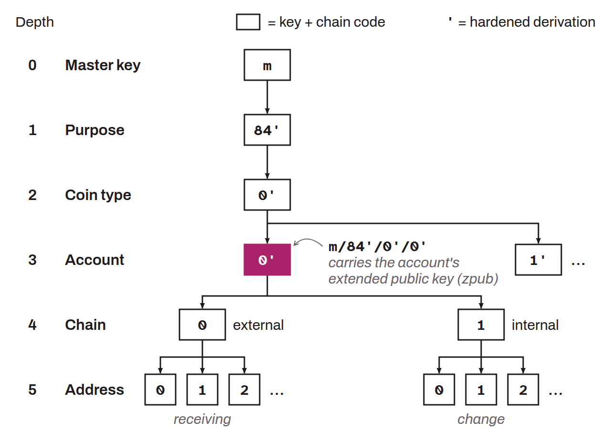

Derivation layer at depth 3 in a hierarchical deterministic (HD) wallet according to BIP-0044 (BIP-0032 placed it at depth 1). Each account is numbered sequentially starting from `/0'/` (hardened derivation, so in reality `/2^31/` or `/2,147,483,648/`). Every node of the tree is an extended key, but it is at this depth that the account's extended public key is usually exported, the well-known `xpub` (a `zpub` for a BIP-0084 account, only the prefix changes). Nowadays, a single account is generally used within an HD wallet. Originally, however, accounts were conceived to segregate various categories of use within a single wallet. For example, take the standard derivation path for an external Taproot (P2TR) receiving address: `m/86'/0'/0'/0/0`. The account index is the second `/0'/`.

