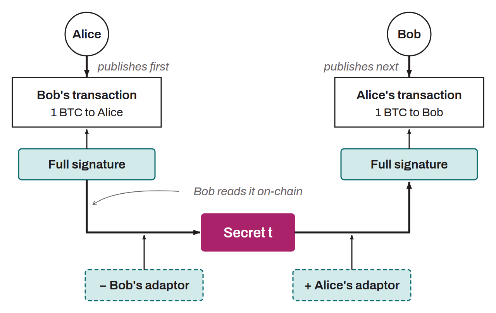

Cryptographic method for combining a valid signature with an additional signature (called an “adaptor signature”) to reveal a secret. The method is built so that knowing any two of the three elements (the valid signature, the adaptor signature, and the secret) is enough to deduce the missing third. One useful property is that a party who knows its counterparty's adaptor signature, along with the specific point on the elliptic curve tied to the secret used to compute it, can derive its own adaptor signature that matches the same secret, without ever having direct access to the secret itself. In an exchange between two parties who do not trust each other, this technique allows two sensitive pieces of information to be revealed simultaneously. It removes the need for trust in instant exchanges such as a coinswap or an atomic swap. Let's take an example. Alice and Bob each want to send 1 BTC to the other, but they do not trust each other. They will therefore use adaptor signatures to avoid having to trust the other party (which makes it an “atomic” swap). They proceed as follows:
* Alice starts the atomic swap. She creates a transaction $m_A$ that sends 1 BTC to Bob. She creates a signature $s_A$ that authorizes this transaction using her private key $p_A$ ($P_A = p_A \cdot G$), a nonce $n_A$, and a secret $t$ ($N_A = n_A \cdot G$ and $T = t \cdot G$):
$$s_A = n_A + t + H(N_A + T \parallel P_A \parallel m_A) \cdot p_A$$

* Alice computes the adaptor signature $s_A'$ from the secret $t$ and her valid signature $s_A$:
$$s_A' = s_A - t$$

* Alice sends Bob her adaptor signature $s_A'$, her unsigned transaction $m_A$, the point corresponding to the secret $T$, and the point corresponding to the nonce $N_A$. This information is called an “adaptor”. Note that with this information alone, Bob cannot claim Alice's BTC.
* Bob can, however, check that Alice is not trying to cheat him. To do so, he verifies that Alice's adaptor signature $s_A'$ matches the promised transaction $m_A$. If the following equation holds, he can be sure that Alice's adaptor signature is valid:
$$s_A' \cdot G = N_A + H(N_A + T \parallel P_A \parallel m_A) \cdot P_A$$

* This verification gives Bob assurance about Alice, so he can continue the atomic swap with confidence. He then creates his own transaction $m_B$ sending 1 BTC to Alice, and his own adaptor signature $s_B'$, which is tied to the same secret $t$ that only Alice knows for now (Bob does not know $t$, only its corresponding point $T$, which Alice gave him):
$$s_B' = n_B + H(N_B + T \parallel P_B \parallel m_B) \cdot p_B$$

* Bob sends Alice his adaptor signature $s_B'$, his unsigned transaction $m_B$, the point corresponding to the secret $T$, and the point corresponding to the nonce $N_B$. Alice can now combine Bob's adaptor signature $s_B'$ with the secret $t$, which only she knows, to compute a valid signature $s_B$ for the transaction $m_B$ that sends Bob's BTC to her:
$$s_B = s_B' + t$$
$$(s_B' + t) \cdot G = N_B + T + H(N_B + T \parallel P_B \parallel m_B) \cdot P_B$$

* Alice broadcasts this signed transaction $m_B$ on the Bitcoin network to collect the BTC that Bob promised her. Bob sees this transaction on the blockchain, so he can extract the signature $s_B = s_B' + t$ from it. From this value, Bob can isolate the secret $t$ that he needed:
$$t = (s_B' + t) - s_B' = s_B - s_B'$$

* This secret $t$ was the only piece Bob was missing to produce the valid signature $s_A$ from Alice's adaptor signature $s_A'$, which will authorize the transaction $m_A$ that sends 1 BTC from Alice to Bob. He computes $s_A$ and in turn broadcasts the transaction $m_A$: $$s_A = s_A' + t$$
$$(s_A' + t) \cdot G = N_A + T + H(N_A + T \parallel P_A \parallel m_A) \cdot P_A$$
