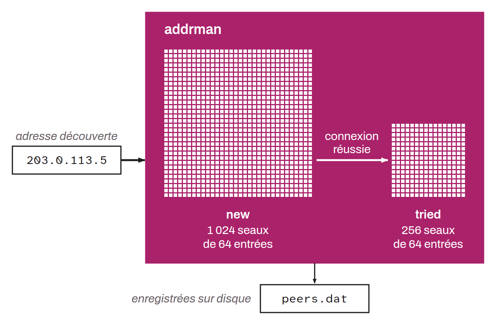

Bitcoin Core module that manages the addresses of known peers on the network. It maintains two in-memory tables: the “new” table, which holds addresses that have been discovered but not yet tested (1,024 buckets of 64 entries), and the “tried” table, which holds addresses the node has already connected to successfully (256 buckets of 64 entries). These tables are serialized in the `peers.dat` file.

The module was introduced by Pieter Wuille in 2012, replacing the previous system, which stored addresses in `addr.dat` with no bucketing structure. Its behavior was strengthened by the addition of feeler connections and the test-before-evict mechanism, which verify the reachability of addresses before promoting or evicting them.
