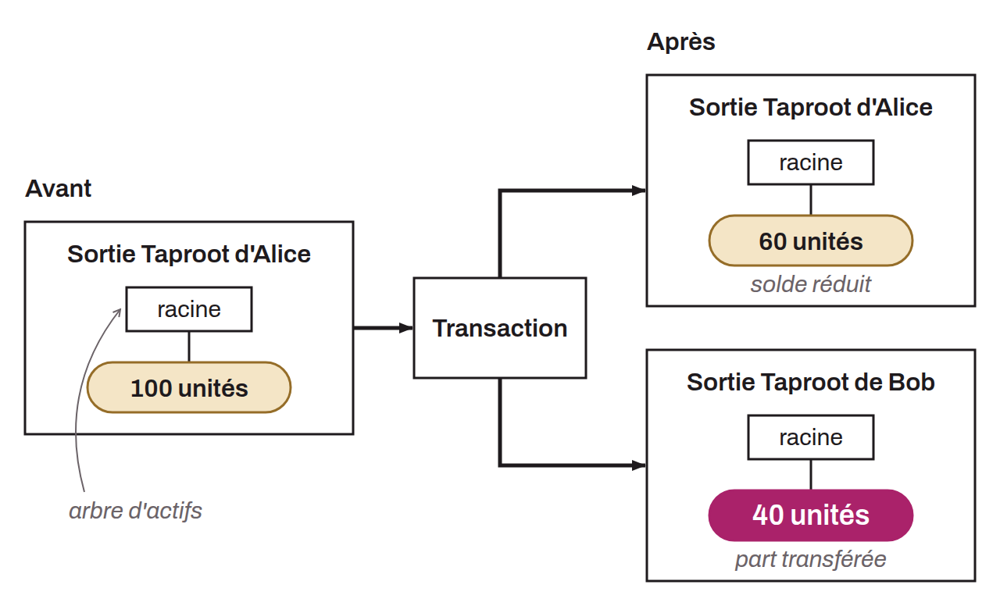

Operation that divides a Taproot Assets asset into two parts spread across separate Taproot outputs. The sender updates the Merkle-Sum Sparse Merkle Tree of its own output by reducing its balance, then the recipient builds a second tree committed in a new Taproot output containing the assets received. Every asset transfer between holders relies on this splitting mechanism. Asset proofs must go all the way back to the genesis transaction to attest to the provenance of the assets after each split. It is the inverse operation of an asset merge.

