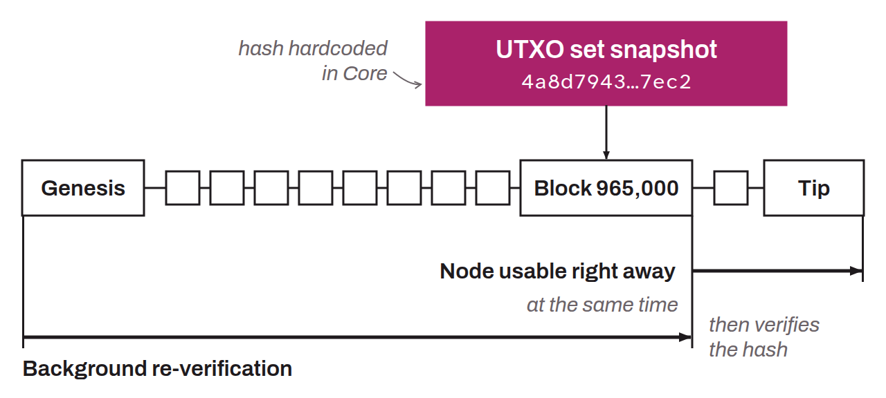

Feature of Bitcoin Core, the most widely used Bitcoin client, that lets a newly initialized node (one that has not yet done the IBD) defer the verification of transactions and of the UTXO set prior to a given snapshot. The concept relies on a UTXO set (the list of all UTXOs existing at a given moment) that the user loads through the `loadtxoutset` RPC command and that is presumed accurate once its hash has been checked against a hash hardcoded in Core, which lets the node sync very quickly to the chain with the most accumulated work. Since the node skips the long IBD step, it becomes functional for its user very quickly. Assume UTXO splits the synchronization (IBD) into two parts:
* First, the node performs the headers-first sync (verification of the headers only) and considers valid the UTXO set whose hash matches the hash hardcoded in Core;
* Then, once it is functional, the node verifies the full block history in the background, updating a new UTXO set that it has verified itself. If the latter does not match the UTXO set initially loaded, the node gives an error message.

Assume UTXO therefore speeds up the setup of a new Bitcoin node by deferring the verification of transactions and of the UTXO set, thanks to a snapshot whose hash is hardcoded in Core.

