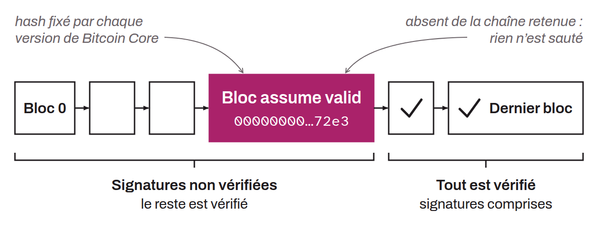

Configuration parameter in Bitcoin Core, the most widely used Bitcoin client, that lets a newly initialized node (one that has not yet done the IBD) skip script verification, and therefore signature verification, for all the transactions included in the blocks prior to a given block. This block is identified by the hash of its header. The chosen block is renewed with each new version of Bitcoin Core. At initialization, since this parameter is enabled by default, the node verifies the chain of block headers to find the branch with the most accumulated work. If the node detects the hash provided by Core in the branch it has selected, and that branch carries at least the minimum work set in Core (`nMinimumChainWork`) and extends at least two weeks' worth of equivalent work beyond the block being connected, it skips script verification for the earlier blocks. Otherwise, the node performs a traditional synchronization (IBD) to verify everything itself.

The goal of Assume Valid is to speed up a node's initial synchronization without compromising security, on the assumption that the majority of the network has already validated these transactions in the past. The only real trade-off for the node is that, in the event of an earlier theft of bitcoin, it will not be warned. However, it can still check that the quantity of bitcoin issued is correct. Nodes keep verifying the scripts and signatures of transactions after the Assume Valid block. This approach rests on the assumption that if a transaction has been accepted by the network for long enough without challenge, it is unlikely to be fraudulent.
