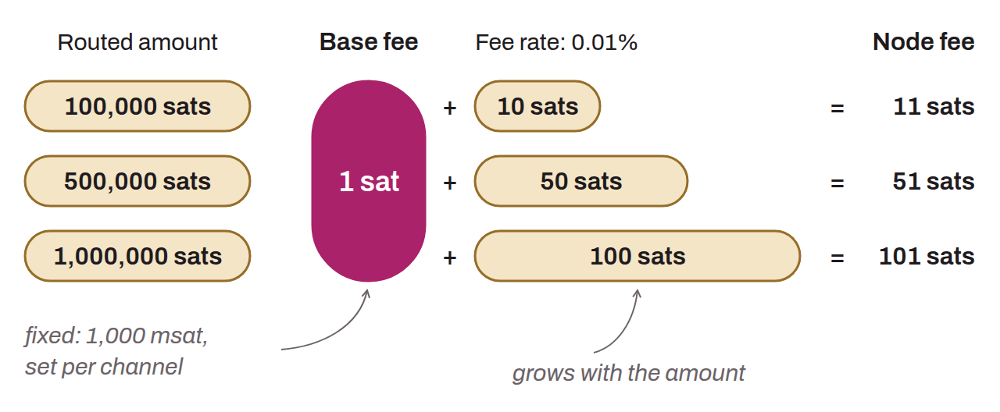

Fixed component of routing fees on the Lightning Network. When a node forwards a payment on behalf of another, it can charge a fee made of two parts: the base fee, a constant amount charged for each routed payment regardless of its amount, and the fee rate, a share proportional to the amount forwarded. The base fee is expressed in millisatoshis and is typically 1,000 msat (that is, 1 satoshi). It can be configured by the node operator for each channel.

