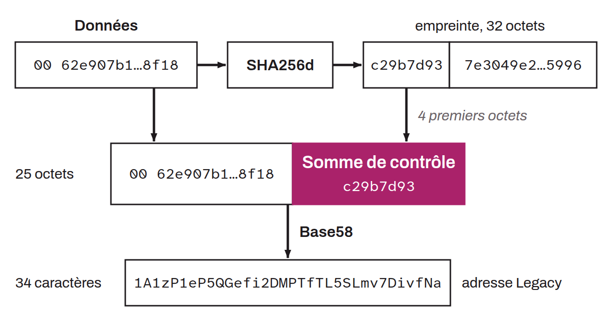

`Base58Check` is an encoding used in the Bitcoin system to represent Legacy receiving addresses and certain other data, such as extended keys, as human-readable strings. It is a variant of the `Base58` system, a positional base-58 representation designed to minimize human transcription errors. It uses a set of 58 alphanumeric characters, made up of the digits `1` through `9`, the uppercase letters `A` through `Z` (except `I` and `O`, to avoid confusion with the digits `1` and `0`), and the lowercase letters `a` through `z` (except the letter `l`, to avoid confusion with the digit `1`). `Base58Check` differs from `Base58` by the addition of a checksum. It is a truncated version of a double `SHA256` hash of the original data (`SHA256d` or `HASH256`), of which only the first 4 bytes are kept. This checksum is concatenated to the end of the same data, still in binary format, and the resulting whole is then encoded in `Base58`. During verification, the checksum is recomputed and compared with the one added at encoding time. If the two checksums match, the data is considered valid; otherwise, a corruption or transcription error is reported.

Using `Base58Check` in Bitcoin addresses and keys offers several advantages. First, it reduces human errors during transcription and reading by avoiding ambiguous characters. Second, it protects against typing errors by detecting and flagging them through the checksum. Third, the compact representation of data in `Base58Check` reduces the space required to store and share addresses and keys. The most recent receiving addresses (post-SegWit) have abandoned this `Base58Check` encoding in favor of `Bech32` and `Bech32m` encodings, which have a more advanced checksum (using BCH codes).
