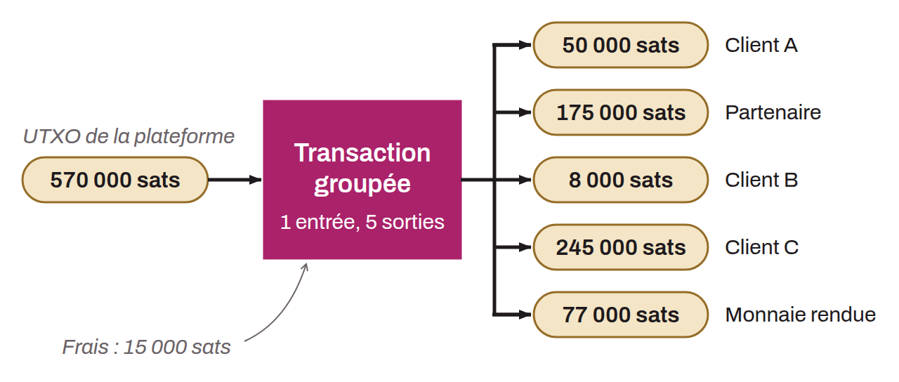

Spending technique used mainly by entities with a high transaction volume, such as exchanges, to optimize and reduce transaction costs. By grouping several payments destined for different recipients into a single Bitcoin transaction, batched spending consumes less space in blocks, which reduces the associated fees. Batched spending stands out through a pattern that is easy to recognize in chain analysis. This pattern shows up as the use of a few UTXOs as inputs (often just one) and the creation of multiple UTXOs as outputs. The interpretation of this pattern is that a batched spend has taken place. Faced with this pattern in chain analysis, an analyst can infer that the input UTXO comes from a company with heavy economic activity and that the output UTXOs will scatter. Some will belong to the company's customers. Others may go to partner companies. Finally, there will certainly be a change output returning to the sending company.

