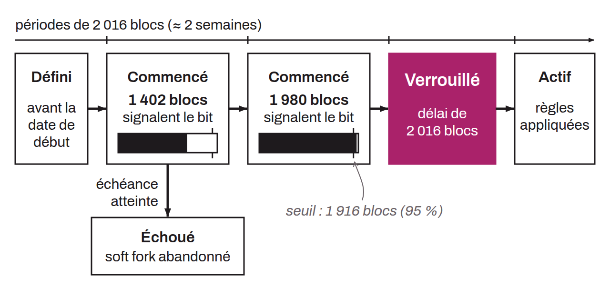

Soft fork activation method for Bitcoin proposed in 2015. It introduces a system where miners signal their support for a soft fork using a specific bit in the block version field. A soft fork proposed under BIP-0009 activates if 95% of the blocks in a 2016-block period (about two weeks, coinciding with each difficulty adjustment) signal their approval. After this lock-in, a delay of 2016 blocks (one period) gives miners and node operators time to prepare for the upgrade before activation. If the 95% threshold is not reached within the maximum timeframe, the soft fork is abandoned. BIP-0009 allows several soft forks to be signaled at the same time, but it gives considerable power to miners, because if the required threshold is not reached, the soft fork is simply abandoned. This was the method initially used for SegWit, before BIP-0148, which suggests using a UASF, reshuffled the cards and forced lock-in through BIP-0091.

