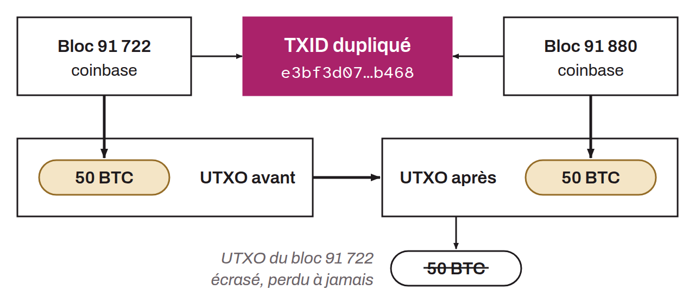

Improvement proposal involving a soft fork implemented on March 15, 2012 to solve the problem of duplicate transaction identifiers. Before BIP-0030, it was technically possible to have two different transactions with the same transaction ID (TXID) in the blockchain. This notably happened twice with coinbase transactions: the one in block 91,880 has the same TXID as the coinbase of block 91,722, and the one in block 91,842 has the same TXID as the coinbase of block 91,812. BIP-0030 fixed this flaw by imposing a simple new rule: no new transaction may have the same TXID as a previously recorded transaction, unless the original transaction has been completely spent (that is, all of its outputs have been used). This soft fork was activated using the flag day method, which makes it one of the first UASFs.

