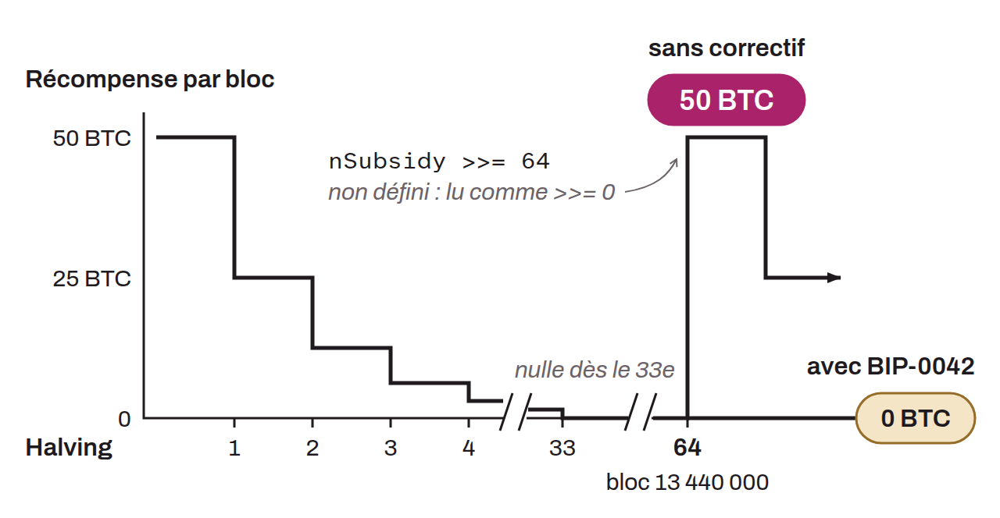

Bitcoin Core improvement proposal that addresses a minor bug in the block reward reduction schedule. This anomaly, if left uncorrected, would have led to a total creation of bitcoin above the planned limit of 21 million. More precisely, after the end of the halvings, a new cycle of bitcoin creation could theoretically have started around the year 2214. The Core code in question used a bitwise right shift on the value of the miner's reward. The bug came from using this shift in a context where the behavior was undefined under the C++ language standard. Right-shifting a 64-bit integer (`int64_t`) by more than 63 bits falls into this category of undefined behavior. In the Bitcoin Core code, this could have happened after 64 halvings, at block height 13,440,000. Beyond this limit, the behavior of the bit shift was undefined, meaning that different builds could interpret the code differently. This could have led to unpredictable results, including the possibility of infinite bitcoin inflation. BIP-0042 fixed this problem by requiring the block reward to be set to zero after 64 halvings, which avoids a right shift in a context of undefined behavior. This change, which was a soft fork, clarified the behavior of the Bitcoin Core code. Although entirely serious, the bug fixed by BIP-0042 was not immediately critical, since it would only have appeared around the year 2214. Published on April 1, 2014 by Pieter Wuille, BIP-0042 stands out for its humorous tone.

