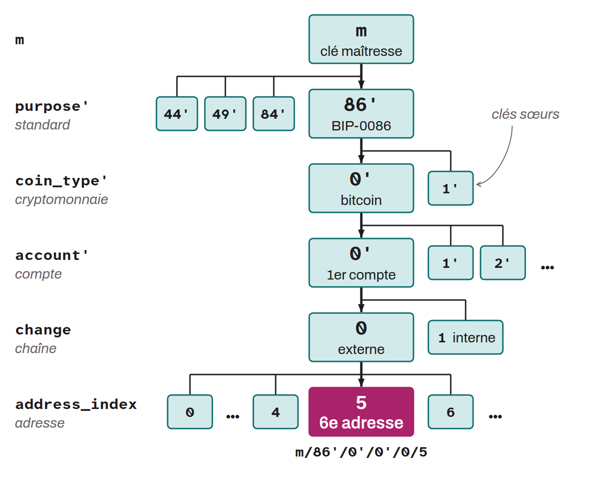

Improvement proposal that introduces a standard hierarchical derivation structure for HD wallets. BIP-0044 builds on the principles set out in BIP-0032 for key derivation and on BIP-0043 for the use of the `purpose` field. It introduces a structure of five derivation levels: `m / purpose' / coin_type' / account' / change / address_index`. Here is the detail of each depth:
* `m /` is the master private key. It is unique to a wallet and cannot have siblings at the same depth. The master key is derived directly from the wallet's seed;
* `m / purpose' /` is the derivation purpose, which identifies the standard followed. This field is described in BIP-0043. For example, if the wallet follows the BIP-0084 standard (SegWit v0), the index will be `84'`;
* `m / purpose' / coin_type' /` is the coin type, that is, the cryptocurrency. It keeps the branches dedicated to one cryptocurrency apart from those dedicated to another in a multi-coin wallet. The index for Bitcoin is `0'`;
* `m / purpose' / coin_type' / account' /` is the account number. This depth makes it easy to separate and organize a wallet into different accounts. These accounts are numbered starting from `0'`. Extended keys (`xpub`, `xprv`, and so on) exist at every level, but this is the level at which the account key is usually exported;
* `m / purpose' / coin_type' / account' / change /` is the chain. Each account as defined at depth 3 has two chains at depth 4: an external chain and an internal chain (also called “change”). The external chain derives addresses meant to be shared publicly, that is, the addresses a wallet offers when the user clicks “receive”. The internal chain derives addresses not meant to be shared publicly, mainly change addresses. The external chain is identified by index `0` and the internal chain by index `1`. Note that from this depth on, the derivation is no longer hardened but normal (there is no apostrophe). This mechanism is what makes it possible to derive all the child public keys from their `xpub`;
* `m / purpose' / coin_type' / account' / change / address_index` is simply the number of the receiving address and its key pair, which tells it apart from its siblings at the same depth on the same branch. For example, the first derived address has index `0`, the second address has index `1`, and so on.

For example, if a receiving address has the derivation path `m / 86' / 0' / 0' / 0 / 5`, the following information can be deduced:
* `86'` indicates that the derivation standard of BIP-0086 (Taproot or SegWit v1) is followed;
* `0'` indicates that it is a Bitcoin address;
* `0'` indicates that it belongs to the first account of the wallet;
* `0` indicates that it is an external address;
* `5` indicates that it is the sixth external address of this account.

