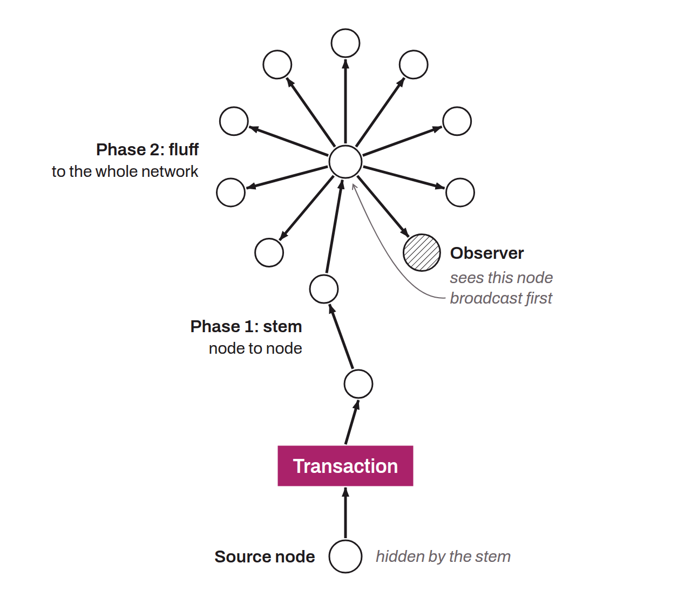

Proposal, known as Dandelion, that aims to improve the privacy of transaction routing in the Bitcoin network to counter deanonymization. In Bitcoin's classic behavior, each node sends transactions to its peers with independent exponential delays (diffusion). If an observer is able to see every transaction relayed by every node on the network, it can assume that the first node to send a transaction is also the node where that transaction originated, and therefore that it comes from the node's operator. This phenomenon can potentially let observers link transactions, normally anonymous, with IP addresses.

The goal of BIP-0156 is to address this problem. To do so, it introduces an additional phase in the diffusion that preserves anonymity before public propagation. Dandelion first uses a “stem” phase, where the transaction is sent through a random path of nodes, before being broadcast to the whole network in the “fluff” phase. Stem and fluff refer to how the transaction travels through the network, which resembles the shape of a dandelion.

This routing method blurs the trail leading to the source node, making it hard to trace a transaction through the network back to its origin. Dandelion therefore improves privacy by limiting adversaries' ability to deanonymize the network. The method is all the more effective when the transaction, during the “stem” phase, crosses a node that encrypts its network communications, as with Tor or P2P Transport V2. BIP-0156 was rejected in June 2020 due to expiration (its status has been `Closed` since April 2025, when BIP-0003 merged the old statuses) and was not integrated into Bitcoin Core.

