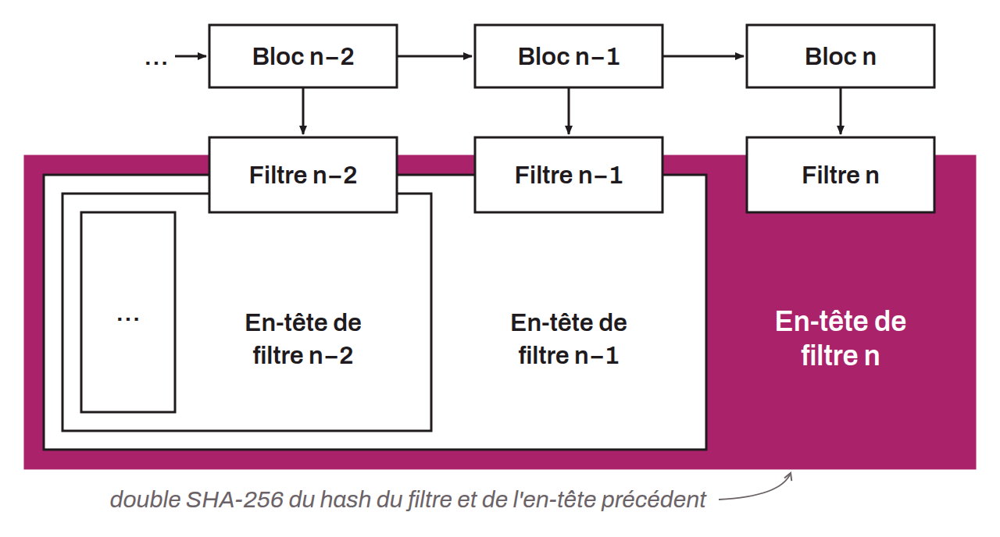

Proposal that defines the peer-to-peer protocol letting light clients download compact block filters from full nodes. This BIP introduces six new P2P messages: `getcfilters` and `cfilter` to request and receive filters, `getcfheaders` and `cfheaders` for filter headers, and `getcfcheckpt` and `cfcheckpt` for checkpoints spaced every 1,000 blocks.

BIP-0157 relies on a system of chained filter headers, similar to block headers. Each header is the double SHA-256 of the concatenation of the filter hash with the previous header, which lets the client verify the authenticity of the filter chain. In case of conflict between peers, the client can download the full block, recompute the correct filter, and identify the faulty peer.

This BIP requires BIP-0158, which specifies the construction of the filters themselves. Written by Olaoluwa Osuntokun, Alex Akselrod, and Jim Posen, it is deployed in Bitcoin Core.
