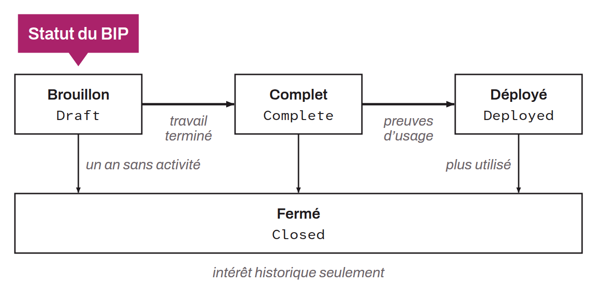

Acronym for *Bitcoin Improvement Proposal*. A BIP is a formal document proposing an improvement, a technical specification, or information related to the Bitcoin protocol and its ecosystem. Since Bitcoin has no central entity to decide on updates, BIPs let the community suggest, discuss, and implement improvements in a structured and transparent way.

Each BIP details the goals of the proposed improvement, the rationale, the potential impacts on compatibility, and the advantages and drawbacks. BIPs can be written by any member of the community. They are primarily owned by their authors and represent their personal recommendation: an individual BIP does not constitute a community consensus or a general recommendation to implement.

Since August 2026, the editors who maintain the BIPs GitHub repository have been Bryan Bishop, Jon Atack, Mark Erhardt (Murch), Olaoluwa Osuntokun, and Ruben Somsen. Their role is administrative and editorial: they check the formatting, relevance, and quality of proposals, but do not assess whether a proposal will be adopted. If someone proposes an improvement that is not accepted within the formal BIP framework, they can still present it directly to the Bitcoin community, or even create a fork including their change. The advantage of the BIP process lies in its formality and centralization, which facilitate debate to avoid splitting Bitcoin users, by seeking to implement updates by consensus. In the end, it is the principle of economic majority that determines the balance of power within the protocol.

BIPs are classified into three types (since BIP-0003, which replaced BIP-0002 in January 2026):
* `Specification BIPs` (formerly “Standards Track”): define a set of technical rules describing a new feature or affecting the interoperability of implementations. They can be implemented, and implementations can conform to their specification. They must contain a reference implementation and test vectors before reaching the “Complete” status;
* `Informational BIPs`: describe a design issue, or provide general guidelines or useful information to the Bitcoin community;
* `Process BIPs`: describe a process surrounding Bitcoin or propose a change to a process. They are treated as living documents, which can be modified indefinitely by rough consensus on the mailing list.

“Specification” and “Informational” BIPs can be classified by layer:
* `Consensus (soft fork)` and `Consensus (hard fork)`: concern Bitcoin's consensus rules, such as changes to the block or transaction validation rules. For example, the SegWit and Taproot BIPs belong to this category;
* `Peer Services`: concerns the operation of the Bitcoin node network, that is, how nodes find and communicate with each other over the Internet;
* `API/RPC`: concerns the application programming interfaces (APIs) and remote procedure calls (RPCs) that let Bitcoin software interact with nodes;
* `Applications`: concerns applications built on top of Bitcoin. BIPs in this category typically deal with changes at the level of Bitcoin wallet standards.

The process of submitting a BIP begins with conceiving and discussing the idea on the Bitcoin Development Mailing List. Authors must first check that the idea has not already been proposed, then present it publicly to gather initial feedback. If the idea is promising and has attracted enough interest in the community, the author writes a BIP following a specific format (MediaWiki or Markdown) and submits it through a pull request on the BIPs GitHub repository. The editors check that the proposal follows the formatting, is relevant, has been discussed beforehand on the mailing list, and is technically feasible. An editor assigns a number only after the proposal has attracted tangible interest in the community. Authors can also name “Deputies”, co-owners of the BIP who assist them in the process.

BIPs go through four statuses during their lifecycle (simplified by BIP-0003 from the nine statuses of BIP-0002):
* `Draft`: the proposal is being written and discussed. A “Draft” BIP with no activity for a year can be closed if its authors do not signal their intent to continue;
* `Complete`: the authors have finished the planned work, and the proposal is clear, complete, and ready for adoption. “Specification” BIPs must include a reference implementation and test vectors. After this status, changes must remain minor. This is the final status of most successful informational BIPs;
* `Deployed`: the BIP is actively used in the ecosystem. This status is reached upon presentation of evidence of actual use (production deployment by an established project, soft fork activation criteria met, etc.). Once deployed, the BIP is considered final and should no longer undergo substantial changes;
* `Closed`: the BIP is no longer actively developed or used and is of historical interest only. This status replaces the former statuses “Deferred”, “Rejected”, “Withdrawn”, “Replaced”, and “Obsolete”.

After reaching the “Complete” status, any change must be documented in a “Changelog” section and versioned according to semantic versioning.
