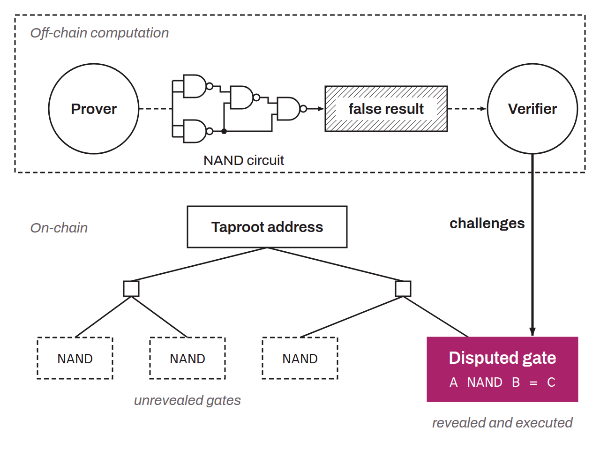

Protocol introduced by Robin Linus in 2023, which aims to extend Bitcoin's application development capabilities. BitVM makes it possible to verify on Bitcoin any computation executed off-chain, and to use its result to direct the committed bitcoin. Bitcoin therefore does not execute the computation: the protocol moves all computation off-chain while allowing the computation to be challenged on-chain if the other party claims a fraudulent result. BitVM thus gives Bitcoin a nearly Turing-complete computing capability, without requiring any change at the consensus level. BitVM reproduces the behavior of a `NAND` logic gate through the joint use of the opcodes `OP_BOOLAND` (which itself reproduces the behavior of an `AND` logic gate) and `OP_NOT` (which reproduces the behavior of a `NOT` logic gate). This `NAND` gate can in turn be used on-chain to reproduce the behavior of all other existing logic gates. This is what is known as a “universal gate”. By extension, a series of `NAND` gates can therefore reproduce any computation circuit. The idea with BitVM is to commit to this circuit in a Taproot address, with one MAST leaf per `NAND` gate.

