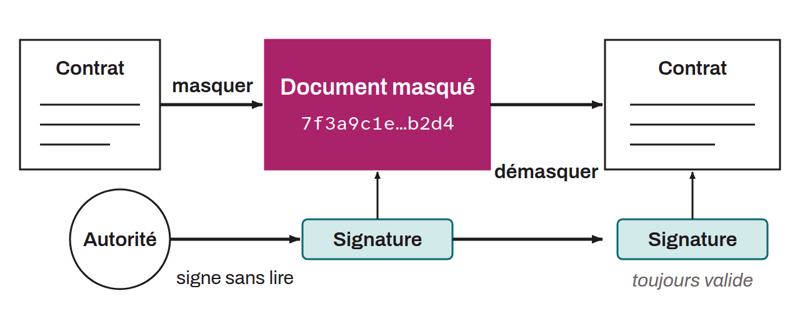

Form of digital signature in which the signer does not know the content of the message being signed, yet the signature can later be verified against the original message. The technique was developed by the cryptographer David Chaum in 1983.

Let's take the example of a company that wants to have a confidential document, such as a contract, authenticated without revealing its content. The company applies a blinding process that cryptographically transforms the original document in a reversible way. The blinded document is sent to a certification authority, which applies a blind signature without knowing the underlying content. After receiving the signed blinded document, the company unblinds the signature. The result is an original document authenticated by the authority's signature, even though the authority never saw the original content.

Chaum's blind signatures can therefore certify the authenticity of a document without knowing its content, which protects both the confidentiality of the user's data and the integrity of the signed document.

On Bitcoin, the protocol appears in layer 2 Chaumian mints (Cashu, Fedimint...), but above all in Chaumian coinjoin protocols, where it ensures that the coordinator cannot link an input to an output.
