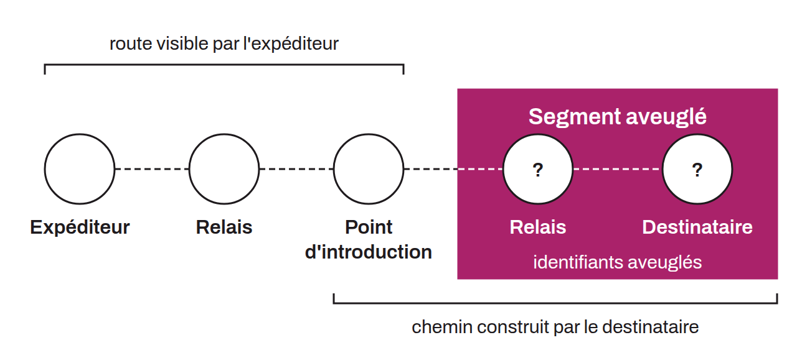

Lightning routing technique that hides part of the payment path to protect the recipient's identity. In classic routing (SPHINX), the sender builds the entire route and therefore knows the recipient's public key. With blinded paths, the recipient encrypts the last hops of the route through an ECDH key exchange: it derives a shared secret with each node in the hidden segment, generates blinded node IDs, and produces encrypted data that lets each relay discover only the next hop. The sender sees the route only up to an introduction point, without knowing the nodes beyond it or the final recipient.

Blinded paths are specified in BOLT-04 and are an important element of BOLT-12 offers, where each invoice includes one or more blinded paths. They can also be used in BOLT-11 invoices through bLIP-0039. Blinded paths also make it possible to route payments through private channels without revealing them. The recipient can add dummy hops to strengthen anonymity, because the sender cannot tell real relays from decoys.
