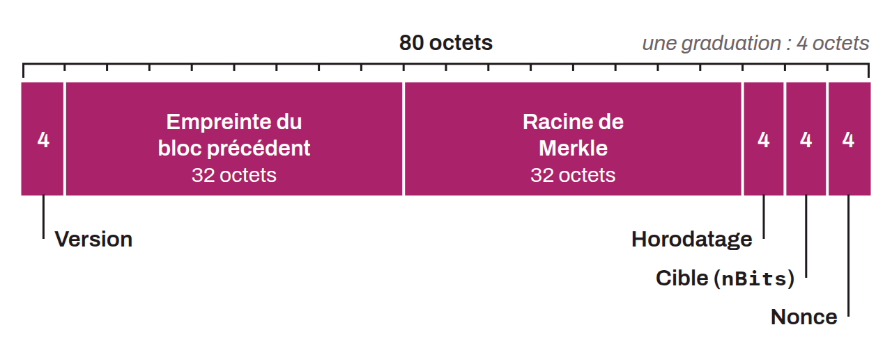

Data structure that serves as the main component in the construction of a Bitcoin block. Each block is made up of a header and a list of transactions. The block header contains the information that ensures the integrity and validity of a block within the blockchain. It holds 80 bytes of metadata and consists of the following elements:
* The block version;
* The previous block hash;
* The Merkle root of the transactions;
* The block timestamp;
* The difficulty target;
* The nonce.



For example, here is the header of block 785,530 in hexadecimal format, mined by Foundry USA on April 15, 2023:

```text
00e0ff3f5ffe3b0d9247dc437e18edc19252e4517cee941752d501000000000000000000206bde3a10826e2acb2f28fba70463601c789293d0c9c4348d7a0d06711e97c0bcb13a64b2e0051743f09a40
```

Breaking this header down, the following elements appear:
* The version:

```text
00e0ff3f
```

* The previous block hash:

```text
5ffe3b0d9247dc437e18edc19252e4517cee941752d501000000000000000000
```

* The Merkle root:

```text
206bde3a10826e2acb2f28fba70463601c789293d0c9c4348d7a0d06711e97c0
```

* The timestamp:

```text
bcb13a64
```

* The target:

```text
b2e00517
```

* The nonce:

```text
43f09a40
```

To be valid, a block must have a header that, once hashed with `SHA256d`, produces a hash less than or equal to the difficulty target.
