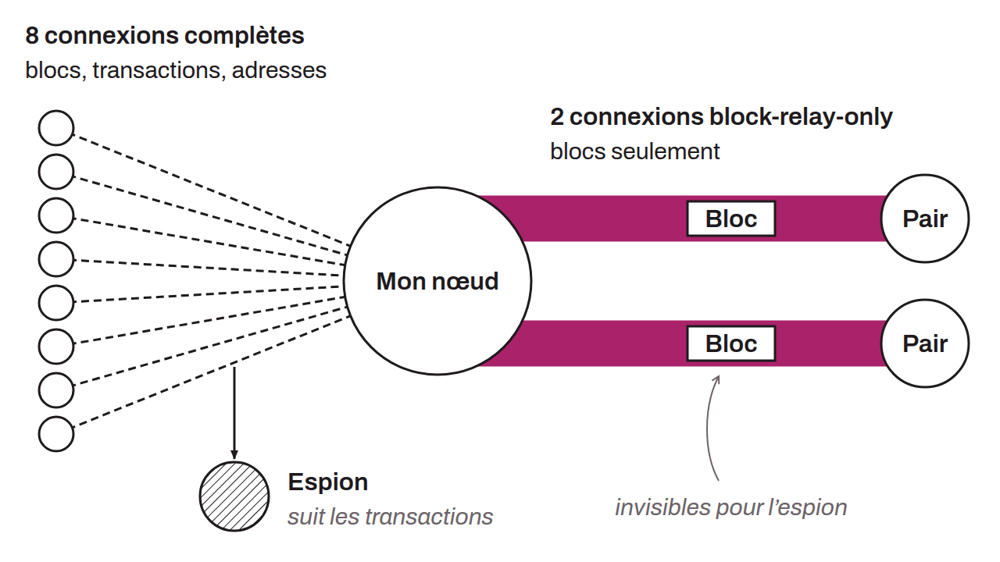

Type of outbound connection in Bitcoin Core that relays only blocks, without exchanging transactions or node addresses. Since version 0.19.0 (November 2019), each node by default establishes 2 block-relay-only connections in addition to its 8 regular outbound connections.

These connections strengthen resistance to network partitioning and protection against eclipse attacks, because they increase the node's connectivity without revealing information about the network topology. Transactions and addresses are the main vectors through which an adversary can map the links between nodes. The absence of these exchanges makes block-relay-only connections invisible to a spy who analyzes transaction propagation. They thus guarantee the node access to the legitimate blockchain even if all of its regular connections are compromised.

