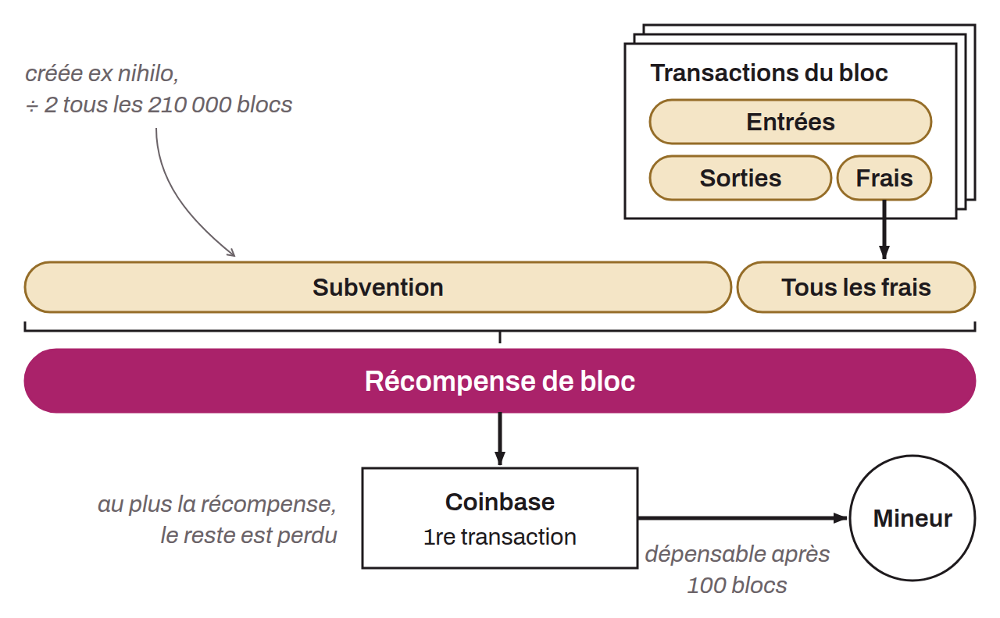

Maximum total amount of bitcoin a miner can collect upon finding a valid block on Bitcoin. This reward is made up of two components: the block subsidy and the transaction fees. The block subsidy is a fixed quantity of bitcoin that the miner can create *ex nihilo*. This quantity gradually decreases over the course of the halvings. Transaction fees are the cumulative fees paid by users to make the transactions included in the mined block. Fees are also bitcoin created by the miner, but their amount is limited to the amount of bitcoin destroyed in the transactions. A transaction's fee is the difference between the total of its inputs and the total of its outputs.

The block reward is distributed within a specific transaction called the "coinbase." The bitcoin it pays out are automatically locked for a period of 100 blocks. This is known as the maturity period. This reward is a ceiling: the coinbase can claim less, and the difference is then lost, but a block whose coinbase claims more is invalid (`bad-cb-amount`).
