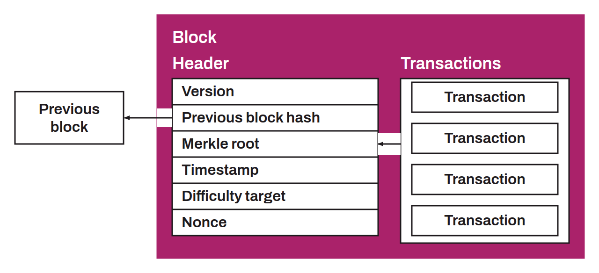

Data structure in the Bitcoin system. A block contains a set of valid transactions and metadata contained in its header. Each block is linked to the next by the hash of its header, forming the blockchain (a chain of blocks). The blockchain acts as a timestamp server that lets every user know all past transactions, to verify the non-existence of a transaction and prevent double spending. Transactions are organized in a Merkle tree. This cryptographic accumulator makes it possible to produce a hash digest of all the transactions in a block, called the “Merkle root”. A block header contains 6 elements:
* The block version;
* The hash of the previous block;
* The root of the Merkle tree of transactions;
* The block timestamp;
* The difficulty target;
* The nonce.

To be valid, a block must have a header that, once hashed with `SHA256d`, produces a hash digest less than or equal to the difficulty target.
