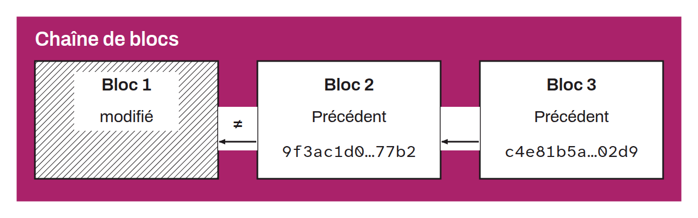

The blockchain is the name commonly given to the distributed timestamp server of the Bitcoin system. It is a chain of blocks. Each block is linked to the next by its cryptographic hash. To prevent double spending on Bitcoin without relying on a central authority, every user must verify the non-existence of a transaction in the system. The only way to be sure a transaction is absent is to be aware of all past Bitcoin transactions. To this end, transactions are timestamped within blocks, and every user holds the entire blockchain.

*Following the many abusive marketing uses of the term “blockchain”, especially in the late 2010s, many bitcoiners refuse to use the word. Some prefer to speak of the “timechain” for this concept. Others, referring to Satoshi Nakamoto's white paper, speak of a “proof-of-work chain”.*
