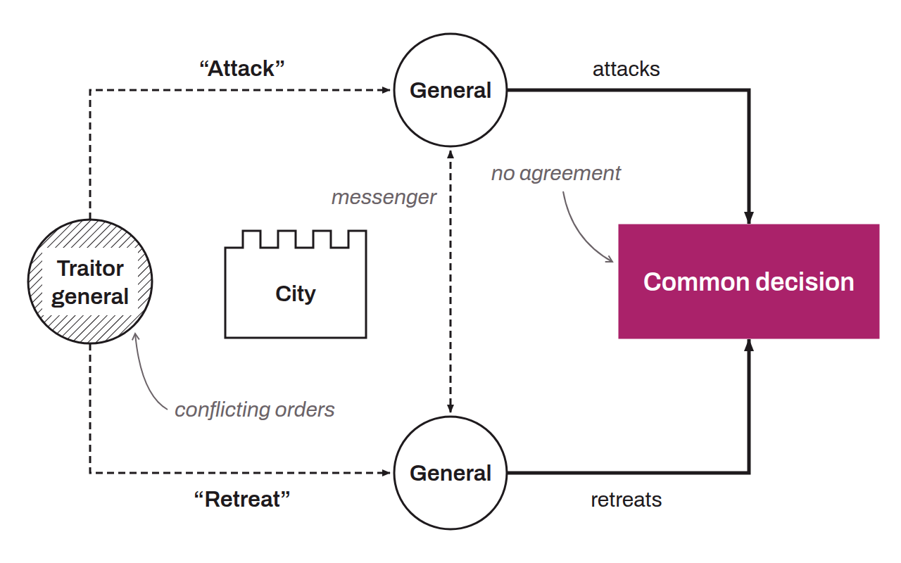

Problem first formulated by Leslie Lamport, Robert Shostak, and Marshall Pease in the scientific journal *ACM Transactions on Programming Languages and Systems*, vol. 4, no. 3, in the paper [“The Byzantine Generals Problem”](https://lamport.azurewebsites.net/pubs/byz.pdf), in July 1982. It is used today to illustrate the decision-making challenges that arise when a distributed system cannot trust any actor.

In this metaphor, a group of Byzantine generals and their respective armies are camped around a city that they want to attack or besiege. The generals are geographically separated from one another and must communicate by messenger to coordinate their strategy. Whether they attack or retreat does not matter, as long as all the generals reach a consensus.

The requirements are therefore the following:
* Each general must make a decision: attack or retreat (yes or no);
* Once the decision is made, it cannot be changed;
* All the generals must agree on the same decision and carry it out in a synchronized way.

Moreover, a general can communicate with another only through messages carried by a courier, which can be delayed, destroyed, altered, or lost. And even if a message is successfully delivered, one or more generals may choose (for whatever reason) to betray the established trust and send a fraudulent message, and sow chaos.

Applied to the Bitcoin blockchain, the dilemma has each general represent a node of the network, which must reach consensus on the state of the system. In other words, the majority of the participants in a distributed network must agree and carry out the same action to avoid a total failure. In the 1982 paper, with simple oral messages, the problem has a solution only if more than two thirds of the generals are loyal. With signed messages that cannot be forged, it can be solved whatever the number of traitors. Bitcoin does not rely on a vote among known participants: Nakamoto consensus rests on proof of work, and the chain retained is the one that accumulates the most work. It therefore holds as long as the majority of the computing power is honest.

*This dilemma is sometimes also called the “consistent broadcast problem.”*
