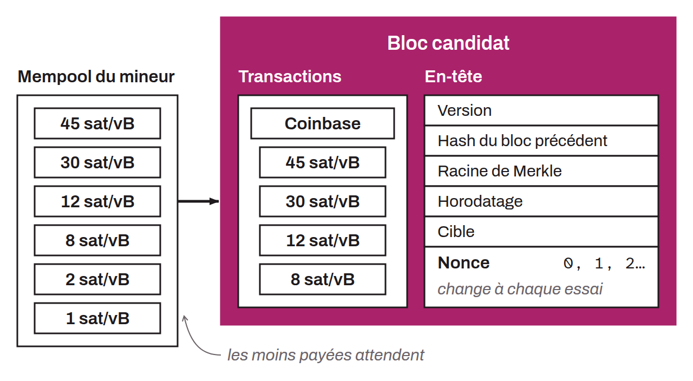

Block being built by a miner taking part in the mining process of the Bitcoin system. The candidate block is a temporary data structure that contains transactions waiting to be confirmed, but does not yet have a valid proof of work to be added to the blockchain. The miner selects the transactions to include in the candidate block according to various factors, such as the associated transaction fees and block size constraints. Once the transactions are selected, the miner generates the block header, which includes the version, a digest of the transactions (the Merkle root), a timestamp, the hash of the previous block, the difficulty target, and a nonce. The miner then tries to find a hash of its header that satisfies the current difficulty target. To do so, it modifies the nonce in the header. It can also modify other information in its candidate block. This is the proof-of-work mechanism. If the miner succeeds in finding a valid hash, the candidate block becomes a valid block and is broadcast to the network to be added to the blockchain.

