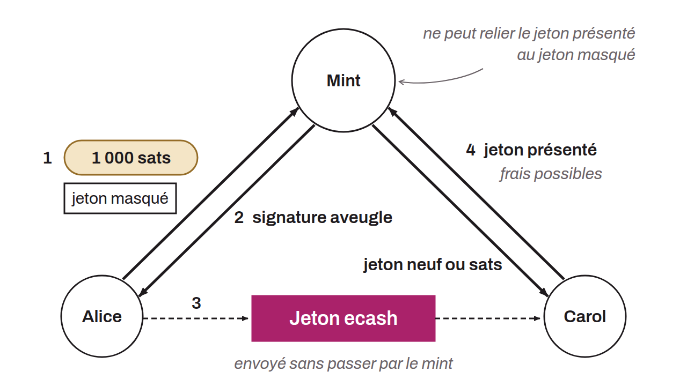

Open-source protocol for Chaumian electronic money, similar to David Chaum's eCash system, but running on Bitcoin and the Lightning Network. More precisely, Cashu is inspired by a variant of eCash proposed in 1996 by David Wagner called "Chaumian ecash without RSA". Cashu can be used with custodial wallets so that the server can identify neither the owners of the funds nor the details of the transactions, which improves privacy. Users can generate Cashu tokens in exchange for bitcoin, and these tokens are signed by the server without it knowing the user. The tokens can then be transferred between users instantly and privately. Until the recipient has swapped them with the mint for new tokens (NUT-03), the sender can still double-spend them, and the mint can charge a fee for this swap (`input_fee_ppk`, NUT-02).

