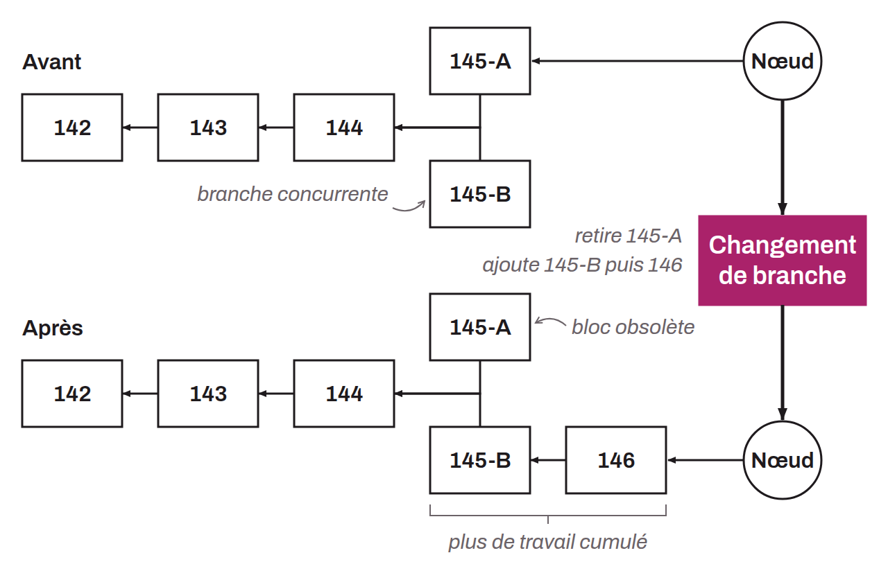

Phenomenon in which the blockchain undergoes a change in its structure because of competing blocks at the same height. It occurs when a portion of the blockchain is replaced by another chain with a greater amount of accumulated work.

These reorganizations are part of Bitcoin's normal operation, where different miners can find new blocks almost simultaneously, splitting the Bitcoin network in two. In such cases, the network can temporarily divide into competing chains. Eventually, when one of these chains accumulates more work, nodes abandon the other chains, and their blocks become what are called "stale blocks" or "orphan blocks". This process of replacing one chain with another is the reorganization.

Reorganizations can have several consequences. First, if a user had a transaction confirmed in a block that ends up abandoned, and the transaction is not in the chain that finally prevails, the transaction becomes unconfirmed again. This is why it is customary to wait for at least 6 confirmations before considering a transaction final. The probability that a reorganization reaches back to a given block decreases exponentially with its depth. Beyond 6 blocks, it becomes negligible in practice, though it is never strictly zero.

Second, at the level of the system as a whole, reorganizations waste miners' computing power. When a split occurs, some miners work on chain `A` and others on chain `B`. If chain `B` is eventually abandoned in a reorganization, all the computing power miners deployed on that chain is, by definition, wasted. Too many reorganizations on the Bitcoin network therefore reduce its overall security. This is in part why increasing the block size or shortening the interval between blocks (10 minutes) can be dangerous.

*Some bitcoiners prefer "orphan block" to refer to a stale block. In everyday language, a reorganization is also commonly called a "reorg".*
