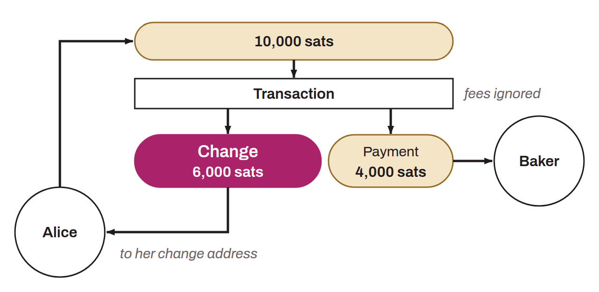

In Bitcoin transactions, the UTXO created with the funds left over after the actual payment has been covered. When the UTXOs used as inputs hold more bitcoin than the amount needed for the actual payment and the transaction fees, the surplus is a UTXO sent back to an internal address of the wallet, called a change address. The change is this UTXO. For example, if Alice wants to pay for a baguette that costs `4,000 sats` with a `10,000 sats` UTXO, her transaction creates a change of `6,000 sats` (ignoring transaction fees).

