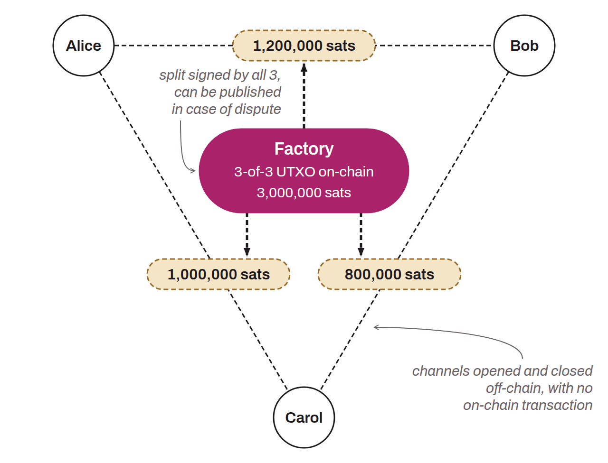

Advanced mechanism under development on Lightning, allowing the creation and management of several payment channels from a single UTXO. Channel factories use `n-of-n` multisig addresses so that a group of users can collectively hold a single UTXO. From there, they can open and close payment channels among themselves without additional on-chain transactions, provided that all members sign each opening or closing. An on-chain transaction is needed only when a member wants to withdraw their funds from the factory or in case of a dispute, which is then settled on the chain (Burchert, Decker, and Wattenhofer, 2018). This method would considerably reduce the costs and the space taken up on Bitcoin by Lightning transactions. In practice, this means that operations that would normally require on-chain transactions for each channel opening or closing can be carried out off-chain, with security guaranteed by the ability to publish the unpublished transactions if needed.

