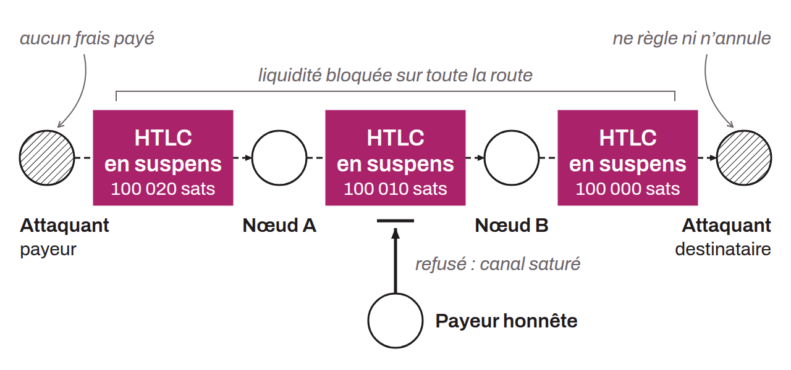

Denial-of-service attack on the Lightning Network that consists of blocking the routing capacity of one or more payment channels for an extended period, preventing honest nodes from routing payments. The attacker sends a fake payment to themselves through a series of intermediate channels, then refuses to settle or cancel the HTLC, which ties up the funds of the routing nodes at no cost to the attacker.

The attack comes in two variants:
* Liquidity jamming (described as early as 2015 under the name "loop attack") exploits the leverage of multi-hop routing: with $x$ bitcoin, an attacker can lock up to $20x$ bitcoin on a path of 20 channels.
* Slot jamming exploits the limit of 483 simultaneous HTLCs per channel: by sending 483 micropayments, an attacker saturates the available slots with minimal capital.

Several mitigation approaches are being explored: upfront fees paid by the sender, a local reputation system between peers, stake certificates, and reputation tokens. bLIP-0004 proposes an HTLC endorsement mechanism as a first concrete measure. No definitive solution has yet reached consensus.
