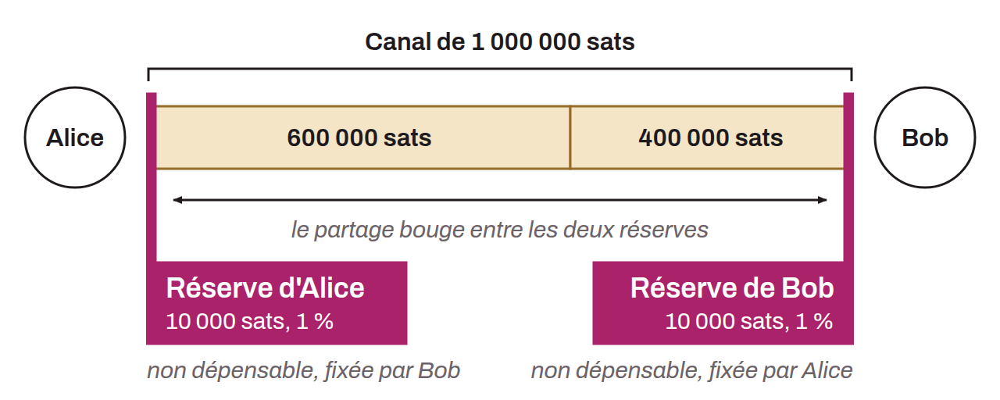

Minimum amount that each party to a Lightning channel must keep on its side and cannot spend. This reserve ensures that each participant always has something to lose in case of an attempted fraud, which makes penalty transactions an economic deterrent.

When a channel is opened, each node imposes a channel reserve on its peer, generally set at 1% of the channel capacity (with a floor of 546 satoshis, matching the dust limit). For example, in a channel of 1,000,000 sats, each party must keep at least 10,000 sats on its side. This threshold is set in the `channel_reserve_satoshis` field during channel negotiation (BOLT-02).

The channel reserve slightly reduces the capacity that can actually be used in a channel. In protocol v1, it can be asymmetric, since each side can impose a different amount. With dual funding (v2), the reserve is fixed at 1% of the total channel balance for both parties and is no longer negotiable.
