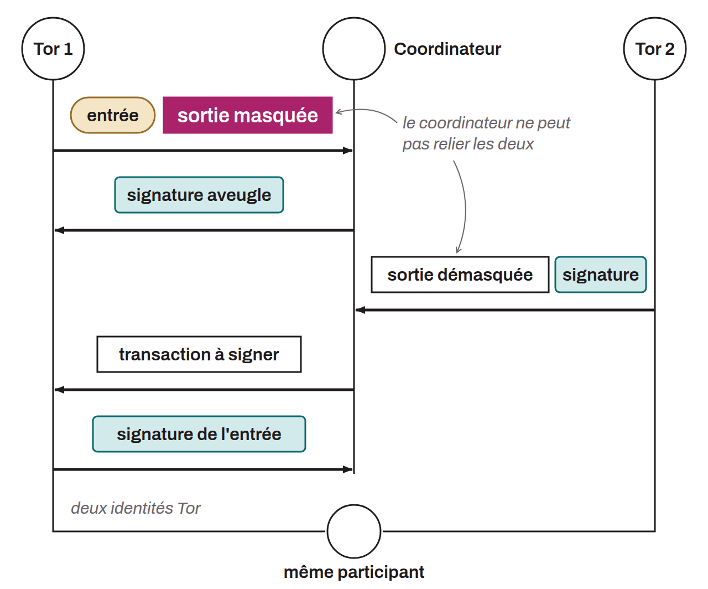

Coinjoin protocol that uses David Chaum's blind signatures and Tor for communications between the participants and the coordinator's server. The goal of a Chaumian coinjoin is to guarantee participants that the coordinator can neither steal the bitcoin nor link inputs to outputs.

To achieve this, users submit their input and a cryptographically blinded receiving address to the coordinator. Once unblinded, this address will receive the bitcoin as a coinjoin output. The coordinator signs these tokens and sends them back to the users. The users then reconnect anonymously to the coordinator's server under a new Tor identity and reveal their output addresses in the clear so that the transaction can be built. The coordinator can verify that all these receiving addresses come from legitimate users, since it signed their blinded version beforehand with its private key. However, it cannot associate a specific output address with a given input user. There is therefore no link between inputs and outputs, even from the coordinator's point of view. Once the coordinator has built the transaction, it sends it back to the participants, who check that their output is in it and sign to unlock their input. The participants send the signature to the coordinator. Once all signatures are collected, the coordinator can broadcast the coinjoin transaction on the Bitcoin network.

This method guarantees that the coordinator can neither compromise the participants' anonymity nor steal the bitcoin during the whole coinjoin process.

It is hard to determine with certainty who first introduced the idea of coinjoin on Bitcoin, and who first thought of using David Chaum's blind signatures in this context. Gregory Maxwell is often thought to have been the first to mention it, in [a BitcoinTalk post in 2013](https://bitcointalk.org/index.php?topic=279249.0):

> *"Using chaum blind signatures: The users connect and provide inputs (and change addresses) and a cryptographically-blinded version of the address they want their private coins to go to; the server signs the tokens and returns them. The users anonymously reconnect, unblind their output addresses, and return them to the server. The server can see that all the outputs were signed by it and so all the outputs had to come from valid participants. Later people reconnect and sign."*

Maxwell, G. (2013, August 22). *CoinJoin: Bitcoin privacy for the real world*. BitcoinTalk Forum. https://bitcointalk.org/index.php?topic=279249.0

However, there are earlier mentions, both of Chaum signatures in the context of mixing and of coinjoins. [In June 2011, Duncan Townsend presented on BitcoinTalk](https://bitcointalk.org/index.php?topic=12751.0) a mixer that uses Chaum signatures in a way quite similar to modern Chaumian coinjoins. In the same thread, there is [a post by hashcoin in reply to Duncan Townsend](https://bitcointalk.org/index.php?topic=12751.msg315793#msg315793) to improve his mixer. That post describes what looks most like coinjoins. A similar system is also mentioned in [a post by Alex Mizrahi in 2012](https://gist.github.com/killerstorm/6f843e1d3ffc38191aebca67d483bd88#file-laundry), when he was advising the creators of Tenebrix. The term "coinjoin" itself was reportedly not coined by Greg Maxwell but came from an idea of Peter Todd.
