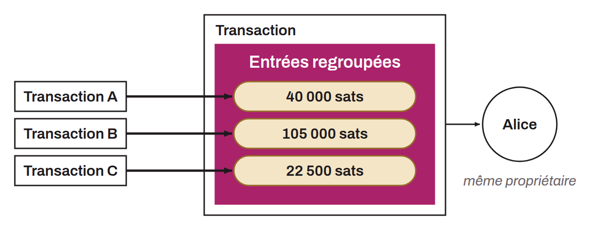

Acronym for *Common Input Ownership Heuristic*. A heuristic used in Bitcoin chain analysis that assumes all the inputs of a transaction belong to a single entity or user. When looking at the public data of a Bitcoin transaction and spotting several inputs, then, unless patterns or other information contradict it, it can be estimated that all the inputs of that transaction belonged to one and the same person (or entity).

This analysis heuristic was identified by Satoshi Nakamoto himself, who discusses it in section 10 of the white paper:

> *"Some linking is still unavoidable with multi-input transactions, which necessarily reveal that their inputs were owned by the same owner. The risk is that if the owner of a key is revealed, linking could reveal other transactions that belonged to the same owner."* - Nakamoto, S. (2008). "Bitcoin: A Peer-to-Peer Electronic Cash System". Retrieved from https://bitcoin.org/bitcoin.pdf.

To this day, CIOH remains the main heuristic used by chain analysis firms, along with address reuse.

