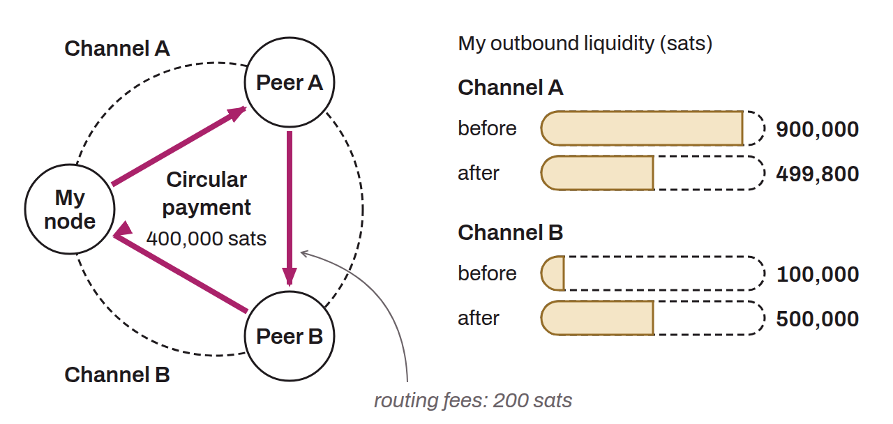

Payment that a Lightning node sends to itself along a route through other nodes of the network. The goal is to move liquidity from one channel to another without opening or closing any channel. For example, if a node has a lot of outbound liquidity on channel A but lacks outbound liquidity on channel B, it can send itself a circular payment that leaves through A and comes back through B, thus rebalancing both channels. This operation has a cost, equal to the routing fees charged by the intermediate nodes.

