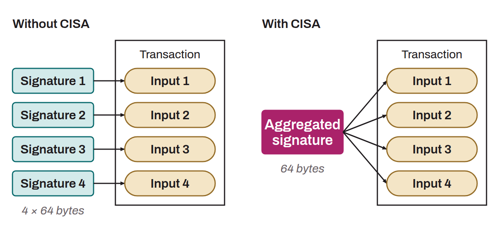

Acronym for *Cross-Input Signature Aggregation*. A technical proposal aimed at optimizing the size of Bitcoin transactions by reducing the number of signatures required to validate them.

Currently, on Bitcoin, each input of a transaction must have an individual signature to be spent. This proves that the owner of the UTXO in question authorizes the transaction. With CISA, the goal is to combine the signatures of all the inputs of a transaction into a single signature that covers all the inputs. This would reduce the size of transactions with many inputs, and therefore their fees. It would be especially useful for people doing coinjoins or consolidations, while also allowing more transactions to be confirmed on Bitcoin without changing the size or the interval of blocks. CISA relies on the Schnorr protocol, which allows linear aggregation of signatures. This means that a single signature can prove possession of several independent keys.

However, implementing CISA on Bitcoin is very complex, because it requires deep changes to the way scripts work. Currently, script verification on Bitcoin is done input by input. Moving to a model where an entire transaction is verified at once, as CISA proposes, is far from a trivial change.
