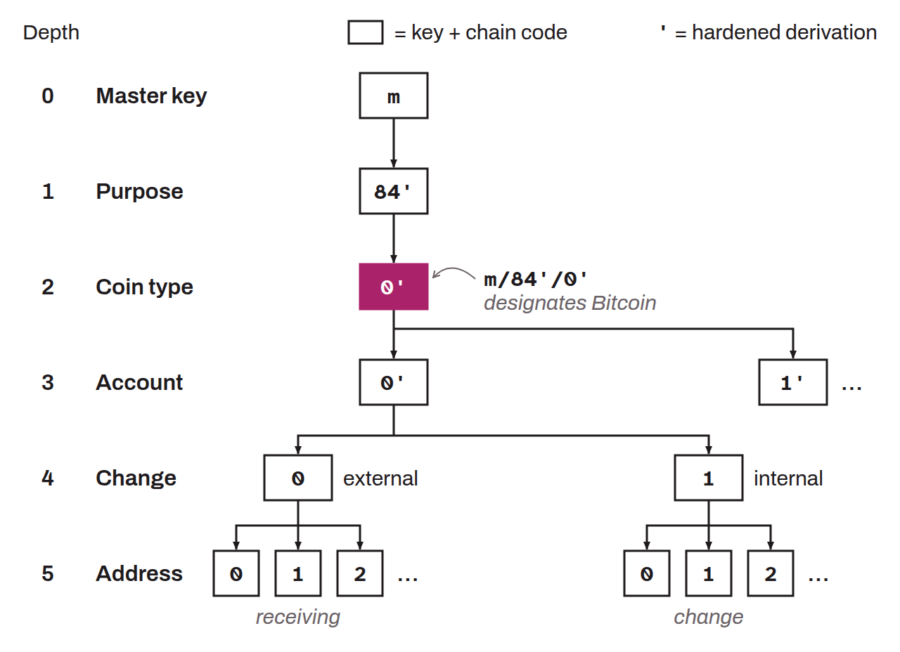

In hierarchical deterministic (HD) wallets, the coin type is a derivation level that distinguishes the wallet's branches according to the different cryptocurrencies used. This derivation level, defined by BIP-0044, sits at depth 2 of the derivation structure, after the master key and the purpose. For example, for Bitcoin, the assigned index is `0x80000000`, written `/0'/` in the derivation path. This means that all addresses and accounts derived from this path are associated with Bitcoin. This derivation level cleanly separates the different assets in a multi-currency wallet. The indexes used for various cryptocurrencies are:
* Bitcoin: `0x80000000`;
* Bitcoin testnet: `0x80000001`;
* Litecoin: `0x80000002`;
* Dogecoin: `0x80000003`;
* Ethereum: `0x8000003c`...

