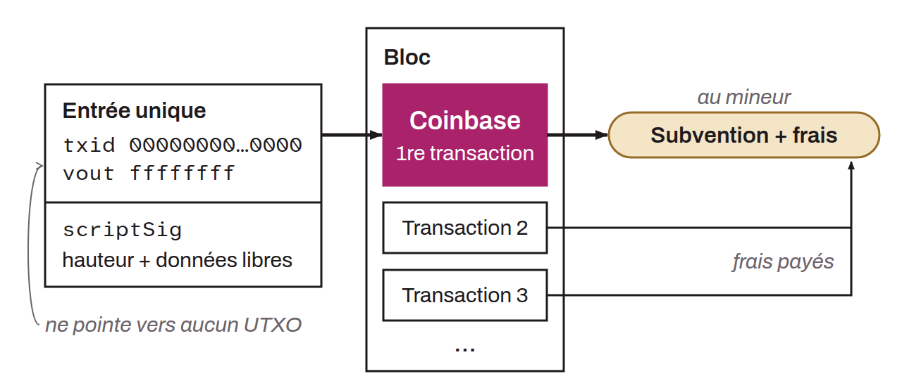

Special, unique transaction included in every block of the Bitcoin blockchain. It is the first transaction of a block and is created by the miner who found a header that satisfies the proof of work, meaning a header whose hash is less than or equal to the target.

The coinbase transaction serves two main purposes: it assigns the block reward to the miner and adds new units of bitcoin to the circulating money supply. The block reward, the economic incentive for miners to perform the proof of work, consists of the fees accumulated from the transactions included in the block plus a fixed amount of bitcoin created ex nihilo (the block subsidy). This amount, initially set at 50 bitcoin per block in 2009, is cut in half every 210,000 blocks (roughly every 4 years) in an event called the halving.

The coinbase transaction differs from regular transactions in several ways. First, it has a single input, but that input references no existing output: its previous transaction hash is null and its index is `0xffffffff`. No UTXO is therefore consumed. Second, the signature script (`scriptSig`) of the coinbase transaction usually contains an arbitrary field in which extra data can be embedded, such as custom messages or mining software version information. Finally, the bitcoin generated by the coinbase transaction is subject to a maturity period of 100 blocks (101 confirmations) before it can be spent, to prevent the spending of nonexistent bitcoin in the event of a chain reorganization.

