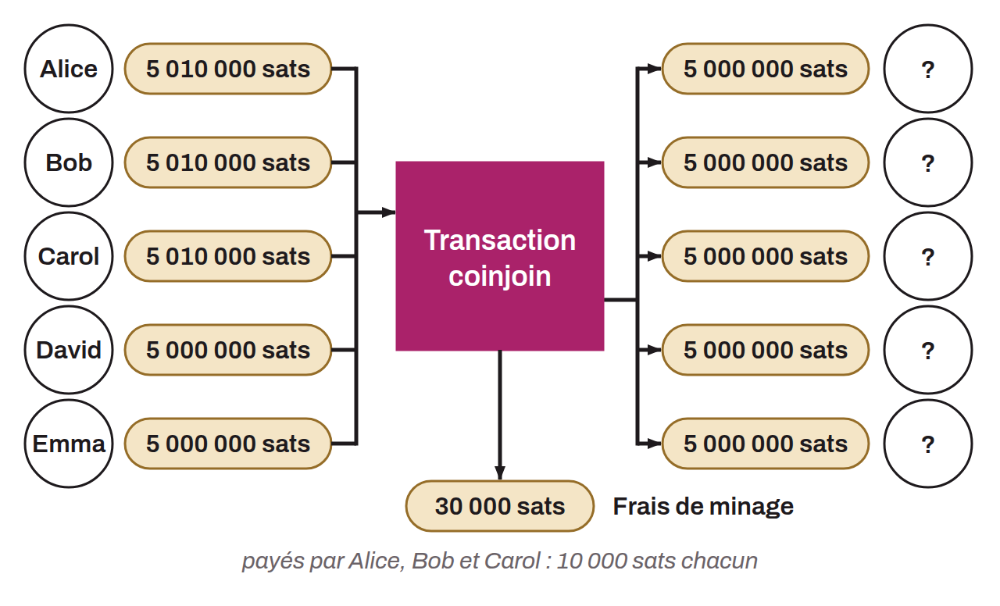

Technique that breaks the traceability of bitcoin. It relies on a collaborative transaction with a specific structure of the same name: the coinjoin transaction. Coinjoin transactions improve the privacy of Bitcoin users by making transaction analysis harder for outside observers. This structure mixes several coins in a single transaction, making it difficult to determine the links between the input and output addresses.

The general principle of a coinjoin is as follows: several users who want to mix each contribute an amount as an input of a transaction. These inputs are redistributed into several outputs, most often of the same amount (give or take fees, and sometimes with change). Looking at the transaction, it is therefore difficult to tell which output belongs to which user. The link between inputs and outputs is not removed but made ambiguous: the transaction does not indicate which input funds which output. The link between each user and each UTXO is blurred, and so is the history of each coin.



For a coinjoin to work without any user ever losing control of their funds, the transaction is first built by a coordinator and then sent to each user. Each of them signs the transaction separately after checking that it suits them, then all the signatures are added to the transaction. If a user or the coordinator tries to steal the funds of the others by modifying the outputs of the coinjoin transaction, the signatures become invalid and the nodes reject the transaction. When the registration of the participants' outputs uses Chaum blind signatures to avoid any link to the input, the result is called a "Chaumian coinjoin".

This mechanism increases transaction privacy without requiring any change to the Bitcoin protocol. Specific coinjoin implementations such as Whirlpool, JoinMarket, or WabiSabi offer solutions to ease the coordination between participants and make the coinjoin transaction more effective. Here is an example of a coinjoin transaction:

```text
323df21f0b0756f98336437aa3d2fb87e02b59f1946b714a7b09df04d429dec2
```

It is hard to determine with certainty who first introduced the idea of coinjoin on Bitcoin, and who first thought of using David Chaum's blind signatures in this context. Gregory Maxwell is often thought to have been the first to mention it, in [a BitcoinTalk post in 2013](https://bitcointalk.org/index.php?topic=279249.0):

> *"E.g. Using chaum blind signatures: The users connect and provide inputs (and change addresses) and a cryptographically-blinded version of the address they want their private coins to go to; the server signs the tokens and returns them. The users anonymously reconnect, unblind their output addresses, and return them to the server. The server can see that all the outputs were signed by it and so all the outputs had to come from valid participants. Later people reconnect and sign."*

Maxwell, G. (2013, August 22). *CoinJoin: Bitcoin privacy for the real world*. BitcoinTalk Forum. https://bitcointalk.org/index.php?topic=279249.0

However, earlier mentions exist, both of Chaum signatures in the context of mixing and of coinjoins. [In June 2011, Duncan Townsend presented on BitcoinTalk](https://bitcointalk.org/index.php?topic=12751.0) a mixer that uses Chaum signatures in a way quite similar to modern Chaumian coinjoins. In the same thread, there is [a post by hashcoin replying to Duncan Townsend](https://bitcointalk.org/index.php?topic=12751.msg315793#msg315793) to improve his mixer. That post describes the closest thing to a coinjoin. A similar system is also mentioned in [a post by Alex Mizrahi in 2012](https://gist.github.com/killerstorm/6f843e1d3ffc38191aebca67d483bd88#file-laundry), when he was advising the creators of Tenebrix. The term "coinjoin" itself is not believed to have been coined by Greg Maxwell but to come from an idea of Peter Todd.

*Some bitcoiners also use the terms "mix" or "mixing" for the coinjoin transaction. Mixing is more precisely the process at the core of a coinjoin. Mixing by coinjoin should also not be confused with mixing by a central party who takes possession of the bitcoin during the process. That has nothing to do with a coinjoin, where the user never loses control of their bitcoin at any point in the process.*
