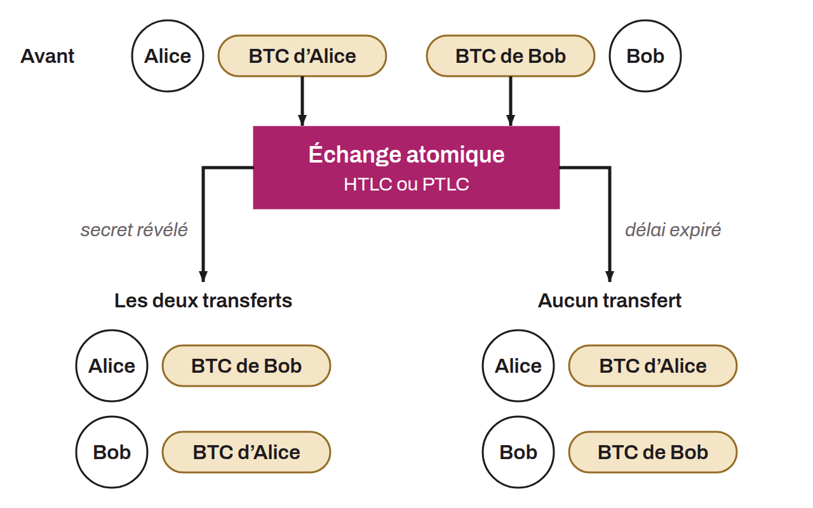

Protocol for a secret transfer of ownership between users. The method transfers the ownership of bitcoin from one person to another, and vice versa, without the exchange being explicitly visible on the blockchain. A coinswap uses smart contracts to carry out the transfer without any need for trust between the parties.

Take a naive example (one that does not work) with Alice and Bob. Alice holds 1 BTC secured by the private key $A$, and Bob also holds 1 BTC, secured by the private key $B$. In theory, they could swap their private keys over an external communication channel to achieve a secret transfer. However, this naive method carries a high trust risk. Nothing prevents Alice from keeping a copy of the private key $A$ after the exchange and using it later to steal the bitcoin once the key is in Bob's hands. Moreover, nothing prevents Alice from receiving Bob's private key $B$ and never handing over her private key $A$ in return. The exchange therefore relies on excessive trust between the parties and fails to ensure a secure secret transfer of ownership.

To solve these problems and allow a coinswap between parties who do not trust each other, smart contract systems are used instead, making the swap “atomic”. These can be HTLCs (Hash Time-Locked Contracts) or PTLCs (Point Time-Locked Contracts). Both protocols work in a similar way, using a timelock system that guarantees the swap is either completed successfully or entirely canceled, which protects the integrity of both parties' funds. The main difference between HTLCs and PTLCs is that HTLCs use hashes and preimages to secure the transaction, whereas PTLCs use adaptor signatures.

In a coinswap scenario using an HTLC or a PTLC between Alice and Bob, the swap is secure: either it succeeds and each receives the other's BTC, or it fails and each keeps their own BTC. It is therefore impossible for either party to cheat or steal the other's BTC.

The use of adaptor signatures is particularly interesting in this context, because it makes it possible to do without traditional scripts (a mechanism sometimes referred to as “*scriptless scripts*”). This reduces the fees associated with the swap. Another major advantage of adaptor signatures is that they do not require a hash common to both parties of the transaction, which avoids revealing a direct link between them in certain types of swaps.
