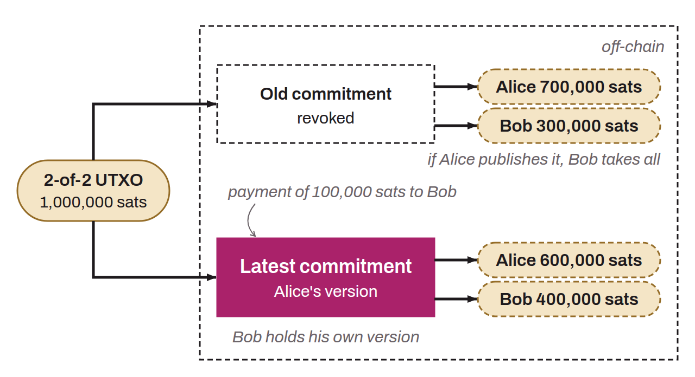

Transaction that each party of a bidirectional Lightning channel holds in its own version, signed by the other, without publishing it on the blockchain. It represents the current distribution of funds between the parties to a channel, and each change of state (adding then settling an HTLC, for example) results in a new commitment transaction. These transactions are valid, but are broadcast only when the channel is closed unilaterally. They contain outputs for each party, reflecting the distribution of funds according to the Lightning payments made since the channel was opened, plus one output per pending HTLC and, depending on the channel type, anchor outputs. Penalty mechanisms are attached to deter parties from broadcasting obsolete channel states, that is, old commitment transactions that reflect an incorrect distribution of funds.

