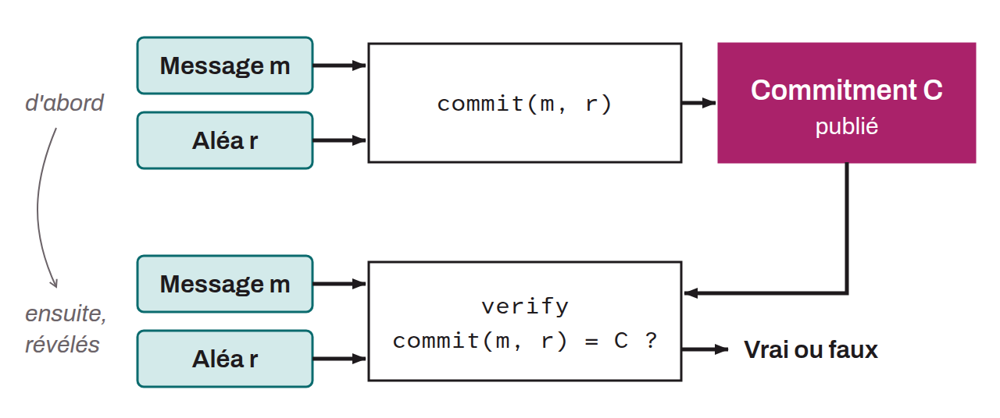

Mathematical object (in the cryptographic sense), written $C$, derived deterministically from an operation on structured data $m$ (the message) and a random value $r$. It is written:
$$
C\ =\ commit(m,\ r)
$$

This mechanism comprises two main operations:
* `Commit`: a cryptographic function is applied to a message $m$ and a random value $r$ to produce $C$;
* `Verify`: $C$, the message $m$, and the value $r$ are used to check that the commitment is correct. The function returns `True` or `False`.

A commitment must satisfy two properties:
* `Binding`: it must be impossible to find a pair $(m', r')$ with $m' \neq m$ such that:
$$
commit(m',\ r')\ =\ C
$$

* `Hiding`: knowing $C$ must not reveal the content of $m$.

In the RGB protocol, a commitment is included in a Bitcoin transaction to prove the existence of a certain piece of information at a given moment, without revealing that information itself.
