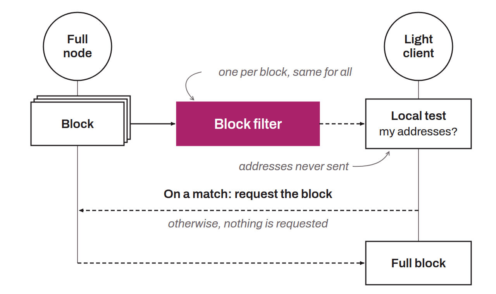

Mechanism that lets light clients check whether a block contains transactions relevant to them, without downloading the entire blockchain and without revealing their addresses to a third-party node. Unlike the Bloom filters of BIP-0037, where the client sends a filter to a full node (thereby exposing its data), here it is the full nodes that generate deterministic filters for each block. The client downloads them, tests them locally, and then fetches the full blocks only when there is a match.

The filters are built according to BIP-0158 using Golomb-coded sets (GCS), a probabilistic structure more compact than Bloom filters. The peer-to-peer distribution protocol is defined in BIP-0157, which introduces dedicated messages (`getcfilters`, `cfilter`, `getcfheaders`...) as well as a system of chained headers for verifying the authenticity of the filters received. A client with at least one honest peer can thus detect any invalid filter.

This mechanism offers better privacy, since blocks can be downloaded from any source, and reduces the computational load on full nodes. In return, the bandwidth consumed in normal operation is higher than with BIP-0037.
