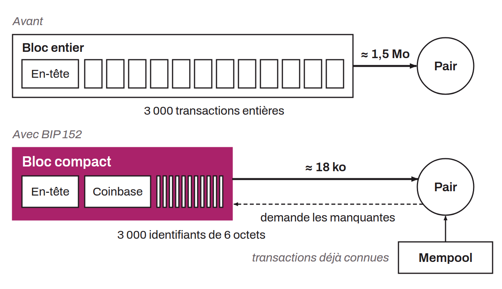

Protocol introduced in Bitcoin Core in 2016 through BIP-0152 that offers a way to save bandwidth for the nodes of the network. Compact block relay communicates block information compactly, based on the assumption that nodes already have most of the transactions of a recent block in their mempool. Rather than transmitting every transaction in full, which would be redundant, compact block relay sends only short identifiers for the transactions already known to peers, along with a few selected transactions (notably the coinbase transaction and those the node is likely not to know). The node can then ask its peers for any missing transactions. Compact block relay thus reduces the amount of data exchanged when blocks propagate, which lowers bandwidth spikes and improves the overall efficiency of the network.

