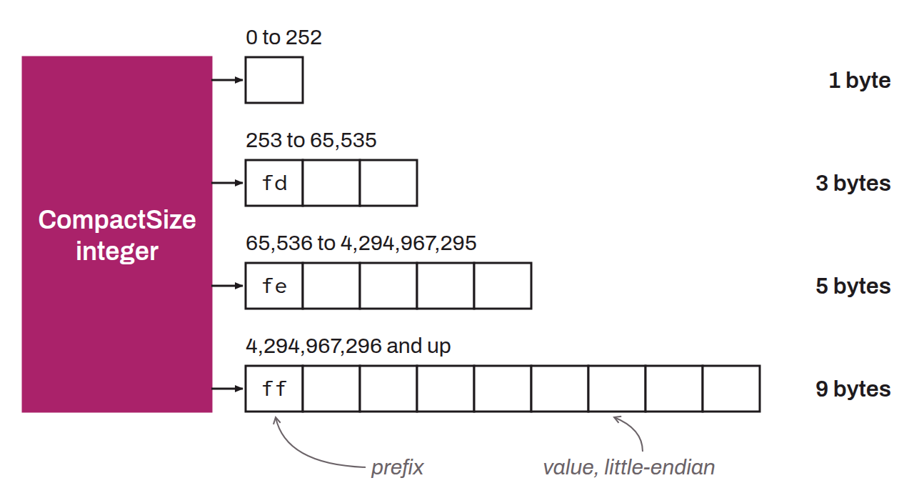

Variable-length encoding format for unsigned integers, used in the Bitcoin protocol to indicate the number of elements or the size of certain fields in transactions and network messages. CompactSize saves space by using fewer bytes for small values. The encoding works as follows:
* values from 0 to 252 are encoded in a single byte;
* values from 253 to 65,535 are preceded by the byte `0xfd` and encoded in 2 bytes in little-endian;
* values from 65,536 to 4,294,967,295 are preceded by `0xfe` and encoded in 4 bytes;
* larger values are preceded by `0xff` and encoded in 8 bytes.

CompactSize is used, for example, to indicate the number of transactions in a block, the number of inputs or outputs in a transaction, or the length of a script.
