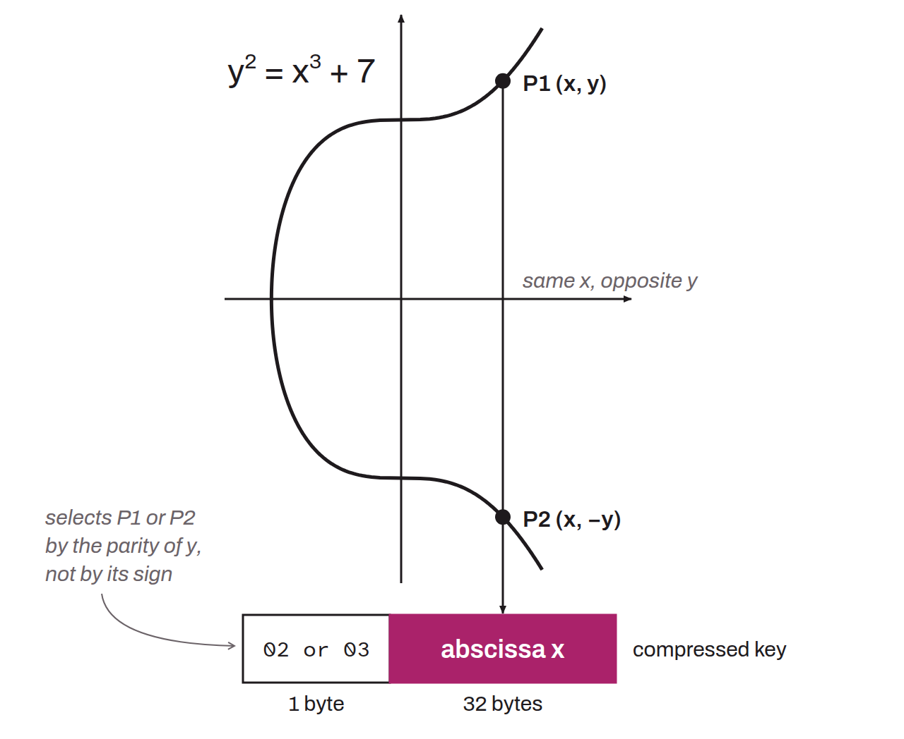

Compact form of a public key, which uses only the `x` coordinate and a prefix (`02` or `03`) that indicates the parity of the `y` coordinate (even or odd). A public key is used in scripts (either directly as a public key or in the form of an address) to receive and secure bitcoin. A raw public key is represented by a point on an elliptic curve, made of two coordinates (`x, y`), each 256 bits. In raw format, a public key is thus 512 bits long, not counting the extra byte that identifies the format. A compressed public key is a more compact way of representing it.

Simplified to the field of the reals, since the elliptic curve is symmetric about the x-axis, for any point $P$ (`x, y`) on the curve there is a point $P'$ (`x, -y`) that is also on the same curve. This means that each `x` corresponds to at most two possible values of `y`, positive and negative. For example, for a given abscissa `x`, there would be two points $P_1$ and $P_2$ on the elliptic curve, sharing the same abscissa but with opposite ordinates:



To choose between the two potential points on the curve, a prefix specifying which `y` to pick is added to `x`. This method reduces the size of a public key from 520 bits to only 264 bits (8 prefix bits + 256 bits for `x`). This representation is known as the compressed form of the public key.

However, elliptic curve cryptography does not use the reals but a finite field of order `p` (a prime number). In this context, the “sign” of `y` is determined by its parity, that is, whether `y` is even or odd. The prefix `0x02` then indicates an even `y`, while `0x03` indicates an odd `y`.

Consider the following example of a raw public key (a point on the elliptic curve) in hexadecimal:
```plaintext
K=04678afdb0fe5548271967f1a67130b7105cd6a828e03909a67962e0ea1f61deb649f6bc3f4cef38c4f35504e51ec112de5c384df7ba0b8d578a4c702b6bf11d5f
```

The prefix, `x`, and `y` can be isolated:
```plaintext
Prefix=04

x=678afdb0fe5548271967f1a67130b7105cd6a828e03909a67962e0ea1f61deb6

y=49f6bc3f4cef38c4f35504e51ec112de5c384df7ba0b8d578a4c702b6bf11d5f
```

To determine the parity of `y`, look at the last hexadecimal character of `y`:
```plaintext
Base 16 (hexadecimal): f
Base 10 (decimal): 15
y is odd
```

The prefix for the compressed public key will be `03`. The compressed public key in hexadecimal becomes:
```plaintext
K=03678afdb0fe5548271967f1a67130b7105cd6a828e03909a67962e0ea1f61deb6
```
