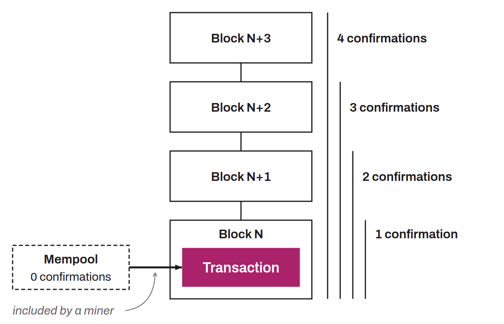

Number of blocks whose security a transaction benefits from. When a transaction is broadcast to the Bitcoin network, it first waits in the mempools of the nodes. A miner then includes it in a valid block. At this stage, the transaction has just been added to the blockchain, so it has one confirmation. When a new block is found on top of the block containing the transaction, it has a second confirmation, and so on. Each new block mined on top of the block containing the transaction is one more confirmation. By counting the number of confirmations of a transaction, it is possible to estimate the risk that it could ultimately be reversed by a reorganization. The number of confirmations makes it possible to judge how immutable a transaction is on the blockchain.

