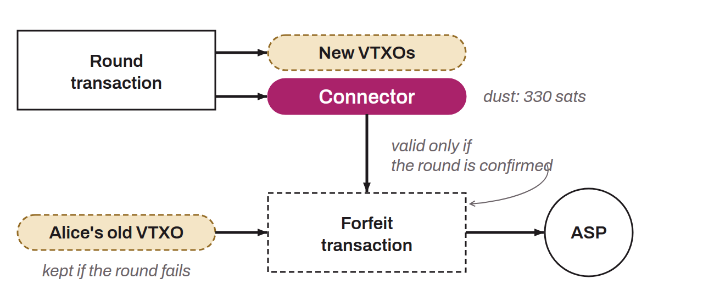

Special output created in the round transaction of the Ark protocol to guarantee atomicity between the surrender of the old VTXOs (via forfeit transactions) and the creation of the new ones. Without this mechanism, a user signing a forfeit transaction would hand control of their VTXO to the ASP with no assurance that the round will succeed and that new VTXOs will be created.

Concretely, in addition to the tree containing the output VTXOs, the round transaction generates a second tree of covenants with one leaf per input VTXO. These leaves are the connector outputs. They carry no significant economic value but serve as a cryptographic link: when a connector output is included as an input of a forfeit transaction, that transaction becomes valid only if the round transaction is confirmed on-chain. If the round fails, the forfeit transaction is invalid and the user keeps their original VTXO. This mechanism ensures that the two operations (forfeiture and creation) are inseparable.

