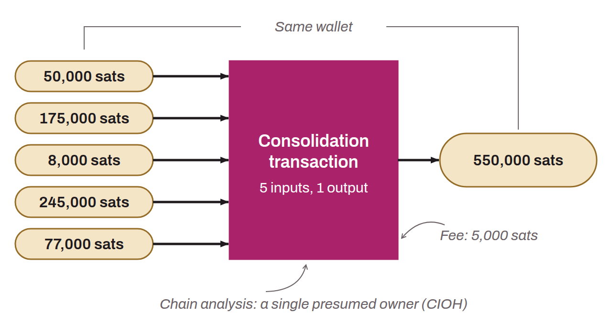

Specific transaction in which several small UTXOs are merged as inputs to form a single, larger UTXO as output. The operation is a transaction made to one's own wallet. The goal of consolidation is to take advantage of periods when fees on the Bitcoin network are low to merge several small UTXOs into a single one of greater value. This anticipates the spending that will be required if fees rise, saving on future transaction fees.

Transactions with many inputs are heavier and therefore more expensive. Beyond the savings on transaction fees, consolidation is also a form of long-term planning. If a wallet contains very small UTXOs, they can become unusable if the Bitcoin network enters a prolonged period of high fees. For example, if a 10,000-sat UTXO has to be spent but the minimum mining fees amount to 15,000 sats, the spend would exceed the value of the UTXO itself. Such small UTXOs then become economically irrational to use and remain unusable until fees drop. These UTXOs are commonly called “dust”. By regularly consolidating small UTXOs, this risk associated with fee increases is reduced.

However, consolidation transactions are recognizable in chain analysis. Such a transaction signals a CIOH (common-input-ownership heuristic), meaning that the inputs of the consolidation transaction are owned by a single entity. This can have privacy implications for the user.

