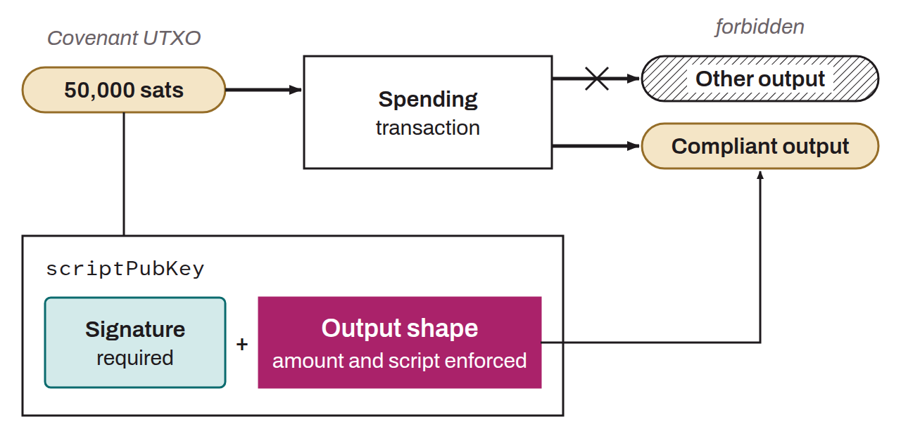

Mechanism that imposes specific conditions on how a given UTXO can be spent, including in future transactions. Beyond the conditions usually allowed by the Script language on a UTXO, a covenant enforces additional constraints on how that UTXO can be spent in later transactions. Technically, a covenant is established when the `scriptPubKey` of a UTXO places restrictions on the `scriptPubKey` of the outputs of a transaction that spends that UTXO. By widening the scope of Script, covenants would allow many developments on Bitcoin, such as the two-way peg of drivechains, the setup of vaults, or the improvement of layer 2 systems like Lightning. Covenant proposals are distinguished by three criteria:
* Their scope;
* Their implementation;
* Their recursiveness.

There are many proposals that would enable covenants on Bitcoin. As of October 2026, in the BIPs repository, `OP_CHECKTEMPLATEVERIFY` (CTV, BIP-0119), `SIGHASH_ANYPREVOUT` (APO, BIP-0118), and `OP_CHECKSIGFROMSTACK` (CSFS, BIP-0348) have “Draft” status, `OP_CAT` (BIP-0347) has “Complete” status, and `OP_VAULT` (BIP-0345) has “Closed” status. Other proposals include `OP_TX`, `OP_TAPLEAFUPDATEVERIFY` (TLUV), `OP_EVICT`, and others.

To understand the concept of a covenant, take an analogy: a safe containing €500 in small bills. Whoever manages to unlock this safe with the right key is free to use the money as they see fit. That is the normal situation on Bitcoin. Now suppose the same safe holds not €500 in banknotes but restaurant vouchers of equivalent value. Whoever opens the safe can use that sum. However, their freedom to spend is restricted, because the vouchers can only pay at certain restaurants. So there is a first condition for spending this money: opening the safe with the appropriate key. But there is also an additional condition on the future use of the sum: it must be spent exclusively at partner restaurants, not freely. This system of constraints on future transactions is what is known as a covenant.

*The term is borrowed from legal terminology, where a covenant is a contractual clause that imposes persistent obligations on a property.*
